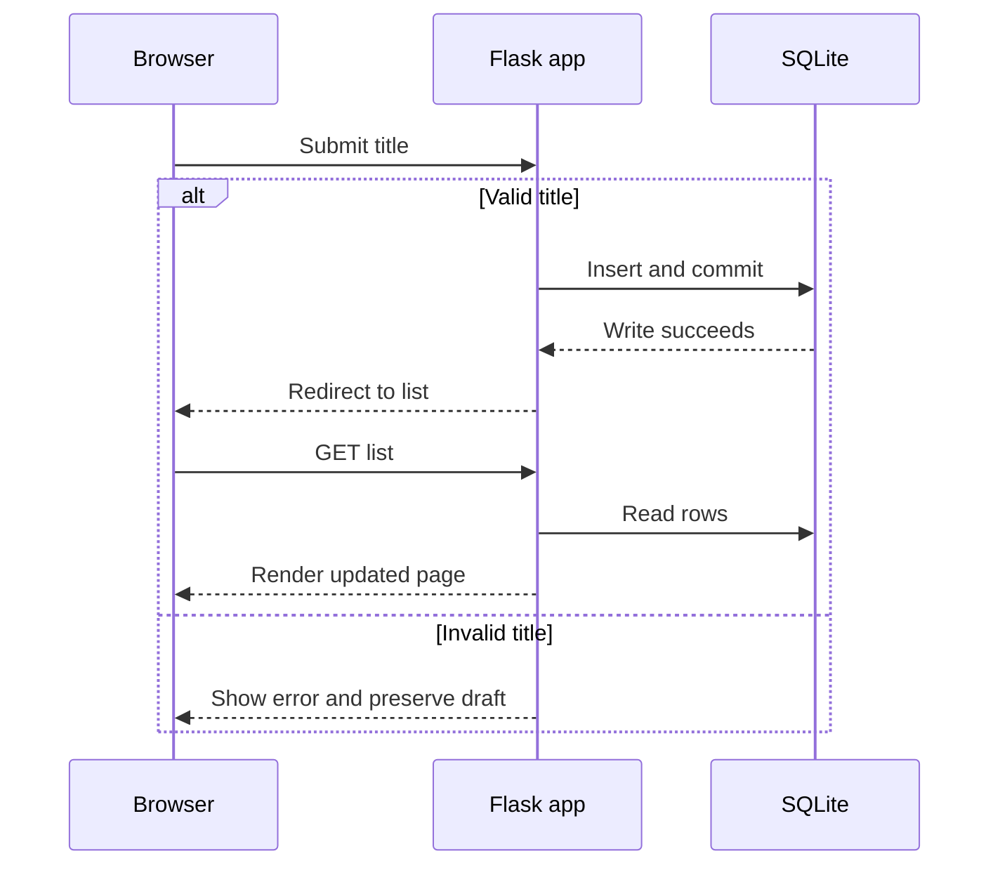

# Design the system from requirements

Before drawing boxes, define a requirement as something a user needs and an acceptance check as what you can observe to prove it. A system boundary tells you what your application is responsible for. Persistence means a saved record survives a restart.

## Clarify the request

The club says “track problems.” Ask who reports, who resolves and whether other devices need to see the same list. Assume one club and one list. Each report has a title and starts open. A resolved report stays visible. The training app is private locally. Any publicly reachable hosted demo uses only fictitious records and can be modified by visitors. A real club rollout would first need authenticated access and a rule for who can resolve.

## Evolve the design

1. **Paper sketch.** Draw a title box, Report button and two sample rows. Walk through reporting a broken projector. This tests the wording and order of actions cheaply.
2. **Browser page.** A fixed HTML sample lets you check readability and keyboard navigation. Reloading a hardcoded page always shows the same data. A shared changing list needs a server.
3. **One backend.** A Flask server receives browser requests, checks rules and renders pages. Start with one app because each feature fits one small service. In-memory rows are useful for a prototype but vanish on restart.
4. **Add SQLite.** Store the issues in one disk file. One table has a generated integer ID, a required trimmed title of 1–100 characters and status limited to open or resolved, default open. Same titles are allowed. Return newest IDs first. One local or hosted app instance keeps the file management simple. Measure slow reads or write contention before considering a separate database server.
5. **Host the same app.** Put the server and persistent file on the host. Keep the path independent of the startup directory. Run the same acceptance tests against the hosted URL, including reload and checking the same record afterward.

| Browser action | Server contract | Stored result |
|---|---|---|
| Open page | GET / returns 200 and issue list, or a clear read error | No change |
| Report | POST /issues accepts title, commits and redirects with 303. Invalid input returns 400 and keeps the draft | New open row |
| Resolve | POST /issues/{id}/resolve commits and redirects. Missing ID returns 404 | Only that row is resolved |

If storage fails, return a clear failure and log technical details on the server. Discuss what to do if storage succeeds but the response is lost. Hint: check the list before submitting again. A redirect handles refresh after success but does not deduplicate two separate submissions.

**Your turn.** Two records say “Projector broken.” How does the Resolve button choose one? Explain your answer before giving the backend task to AI.
