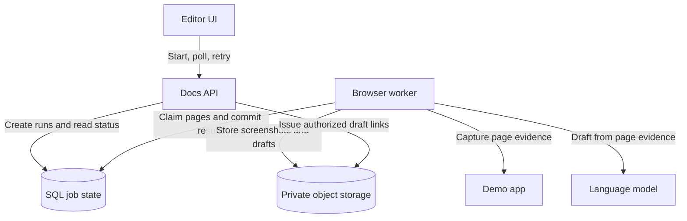

# 001 · Help Doc Generator

An editor needs help docs for 18 pages of a fictional demo app. A browser worker captures screenshots and visible form details, and a language model turns those observations into draft instructions. Sixteen pages succeed. Two fail. The editor should see which pages failed, retry just those pages, and keep the 16 completed drafts.

## Prerequisites

| Concept | What you need here |
| --- | --- |
| HTTP and JSON | The frontend sends a request to create work and reads a status response later. |
| SQL rows, transactions, and unique constraints | A transaction commits related changes together. A unique constraint prevents two records from using the same key. |
| Background worker and polling | A worker processes jobs separately from the web request. Polling means the browser checks status at intervals. |
| Idempotency key | A client-generated identifier reused when retrying the same action, so one action creates one logical result. |
| Lease and claim token | A lease gives a worker temporary ownership of a task. A fresh token for each claim lets the database reject results from an earlier owner. |
| Object storage | Store files such as screenshots and Markdown by key. Store the selected output keys and status in SQL. |
| Structured model output | The model returns fields such as title and steps in a shape the backend can validate. Human review checks whether those fields are accurate. |

For the exercise, use a sheet of paper or a small JavaScript script. If you use JavaScript, refresh arrays, objects, functions, and assertions.

## Try the design first

1. What should the API return before any page finishes?
2. What should be stored once per run, once per page, and once per attempt?
3. Worker A uploads a draft and stalls. Worker B claims the same page after the lease expires and succeeds. When A returns, which draft should the editor see?

Show a hint

The uploaded file and the decision to show it to the editor are separate. Think about which database write makes a draft visible and what that write must check.

## Requirements and assumptions

- Start a run from an approved page list and a fixed demo-app revision. Keep the page list, app revision, and prompt version with the run.
- Show per-page progress, safe error codes, and links to successful drafts. Retry selected failed pages in the same run.
- Keep completed drafts when other pages fail. A separate editor review is required before publication.
- Use these exercise assumptions: 18 pages per run, 2 concurrent runs at a normal peak, 3 worker slots, and about 15 seconds of work per page. Aim to acknowledge a start in under 1 second and reflect committed changes in the UI within 5 seconds during normal operation. These are targets to test.

## Architecture

The API and worker can live in one codebase and run as separate processes. The worker uses a scripted browser such as Playwright to visit approved sample routes, capture visible evidence, and ask the model for a draft. Validate the model response shape and require an editor to verify instructions against the app. Use a sanitized preview for Markdown and keep storage private.

## API and data

| Operation | Contract |
| --- | --- |
| `POST /runs` | Accepts a workspace-scoped page selection and an idempotency key. Returns `202` with the run ID and status URL after the job rows commit. A replay with the same key and canonical payload returns the same result. A different payload with the same key returns `409`. |
| `GET /runs/{runId}` | Returns per-page status, progress totals, and safe failure codes for an authorized editor. |
| `POST /runs/{runId}/retry` | Accepts selected failed page IDs and a separate idempotency key. In one transaction, records the retry command and conditionally requeues eligible rows. Returns the IDs requeued. |

| Record | Fields that matter |
| --- | --- |
| Run | ID, workspace, app revision, prompt version, creation time |
| Page task | Unique `(run_id, page_id)`, status, attempt count, next eligible time, claim token, lease expiry, committed artifact key, last error code |
| Request record | Unique key scoped to workspace, caller, and operation, plus payload hash and original response. For retries, include the run ID in the operation scope. |

## How retries stay safe

1. **Create.** Write the request record, run, and page tasks in a single transaction. Keep the same idempotency key across retries of the same frontend action. A deliberate new run uses a new key.
2. **Claim.** Atomically claim an eligible task with a fresh token and an expiry. Close the transaction before running the browser. Renew the lease while the task is active, using the current token.
3. **Complete.** Upload to a private attempt-specific path such as `runs/r42/pages/settings/attempts/a3/draft.md`. Then set the task to `succeeded` and save the artifact key in a conditional update that checks the task is still running with the same token and an unexpired lease. If the update affects zero rows, discard the result. A cleanup job can later remove unreferenced attempt files after a grace period.
4. **Recover.** Retry transient failures with a capped backoff and jitter. A reaper returns expired claims to the queue when attempts remain, or marks them failed when the attempt budget is exhausted. Invalid capture configuration goes directly to failed with an actionable code.
5. **Retry selected pages.** For an explicit retry, move only the selected rows still marked failed to queued and start a new retry budget for those rows. Serialize competing transitions through conditional updates. Existing successful rows and their artifact pointers stay intact.

**Invariant:** Each run has at most one visible successful draft per page. Duplicate attempts can still consume browser time or model calls, even if only one result becomes visible.

## Estimate and trade-offs

One run requires about 270 worker-seconds. With three slots and evenly timed tasks, that is about 90 seconds with no queue ahead. Two simultaneous runs require about 540 worker-seconds, or 180 seconds to finish both at the same capacity before overhead and retries. Watch queue age to see whether the real workload fits that estimate.

| Decision | Why start here | What would change it |
| --- | --- | --- |
| SQL-backed jobs | Run creation and page scheduling share one transaction. | Consider a separate broker if claims or polling compete with user-facing queries. Use a durable outbox when publishing from SQL to the broker. |
| Polling every few seconds | Easy to implement, and seconds of UI delay are acceptable in this exercise. | Consider server-sent events when many simultaneous viewers or tighter freshness targets justify persistent connections. |
| One task per page | Supports targeted retries and progress reporting. | Group tiny tasks only if scheduling overhead dominates and the product can accept coarser retries. |

## Failure tests and signals

| Test | Expected result |
| --- | --- |
| Submit the same start action twice concurrently | One run and 18 task rows. Both responses reference the same run. |
| Kill a worker after upload but before its conditional update | The page can be reclaimed. Only the winning attempt appears in the UI. |
| Resume a stale worker after another worker succeeds | The stale completion affects zero rows and cannot overwrite the winning artifact. |
| Fail two pages and send overlapping retry requests | Only currently failed selected pages are requeued. The 16 successes retain their original artifacts. |
| Return malformed model output or open a run from another workspace | Malformed output never becomes a successful draft. Unauthorized readers receive neither status nor links. |

Track oldest queued task age, page duration by capture and drafting stage, retry rate by safe error code, and model token usage per run. Correlate logs by run, page, and attempt ID. If queue age rises while capture time stays flat, check worker availability and claim latency before tuning the model.

## 40-minute practice session

| Time | Activity |
| --- | --- |
| 5 min | Recall what an HTTP request, unique key, and transaction do. |
| 10 min | Write the editor's acceptance criteria and sketch the request flow. |
| 15 min | Model three page tasks in JavaScript or on paper. Give one page two different claim tokens and predict which completion the system accepts. |
| 5 min | Replay the crash-after-upload test and find the exact write that protects the result. |
| 5 min | Explain the design aloud, including one trade-off and one failure you can test. |

Reveal a sample interview answer

I would return a run ID as soon as the page tasks are committed. Each page is a separate unit of work, so a failure on two pages doesn't force us to repeat the other 16. The worker uploads to an attempt-specific path and then updates SQL only if it still owns the claim. SQL decides which draft the editor sees. I would start with SQL-backed jobs and polling because the expected load is small, and measure queue age before changing the architecture.

After two or three days, redraw the design from memory and answer this follow-up. If the model provider received the first request but the worker timed out, why can a retry still cost money even though the system publishes only one draft?
