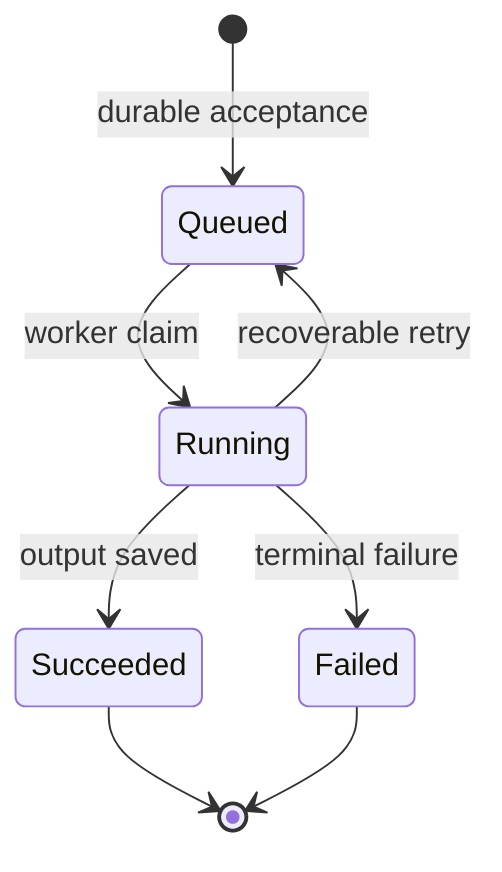

# 010 · Synchronous and Asynchronous API Contracts

[Curriculum index](../../README.md) · [Track index](README.md)

## The problem

A report takes two minutes, but the request gateway times out much earlier.

## Prerequisites

Before this session, review: [001](../../designs/01-http-and-apis/001-http-api-request-response.md)–[004](../../designs/01-http-and-apis/004-consistent-api-error-responses.md); durable storage, state machines.

If an item is unfamiliar, use the [starter glossary](../../START-HERE.md#starter-glossary) and linked earlier notes. You should be able to explain those items in your own words before moving to the worked approach.

## Predict first

Does returning 202 prove that a report will finish?

Write your answer and sketch the relevant state or request sequence before opening the solution.

Hint

Start with one normal operation, then pause it just before and just after its durable change. Identify who owns the truth and what another caller can observe. Use the question above to decide which assumption needs testing.

Worked approach — open after your attempt

## One workable approach

Persist a job before acknowledging acceptance. Return a job ID and status URL; expose queued, running, succeeded, and failed states. Workers claim work with recovery semantics, and the client polls with a reasonable interval or receives notifications. Store an output reference only after the output is ready. Define retention, cancellation, and retries. The HTTP lookup may succeed while the job state is failed; those are different outcomes.

## Flow or state sketch

Boxes represent responsibilities; they do not necessarily require separate deployable services. The text defines the guarantees and limitations.

## Trade-offs and limits

Asynchronous APIs avoid long-held requests but require lifecycle management and user-visible pending states. Small predictable operations are simpler synchronously.

## Failure exercise

Kill the server after acceptance and before processing. The recorded job must remain discoverable and recoverable.

Record the initial state, action sequence, expected durable state, and observed result. Explain the root cause of any mismatch before changing the design.

## 40-minute practice

| Time | Activity |
| --- | --- |
| 5 min | Recall the prerequisites without looking at the notes. |
| 10 min | Read the problem, predict the outcome, and sketch your approach. |
| 15 min | Design an export API including status, failure details, result expiry, and cancellation. |
| 5 min | Run or trace the failure exercise and improve the design. |
| 5 min | Explain your decision, one alternative, and one limitation aloud. |

## Explain and revisit

- What invariant or user promise are you protecting?
- Why does your chosen approach fit this problem?
- What evidence would make you change the design?

Record your attempt in the [practice log](../../PRACTICE-LOG.md). Revisit after 2–3 days and again after a week: redraw the flow and explain the failure without rereading first.

---

[Previous: 009](../../designs/01-http-and-apis/009-conditional-requests-and-concurrent-api-updates.md) · [Next: 011](../../designs/02-data-and-storage/011-relational-data-modeling.md)
