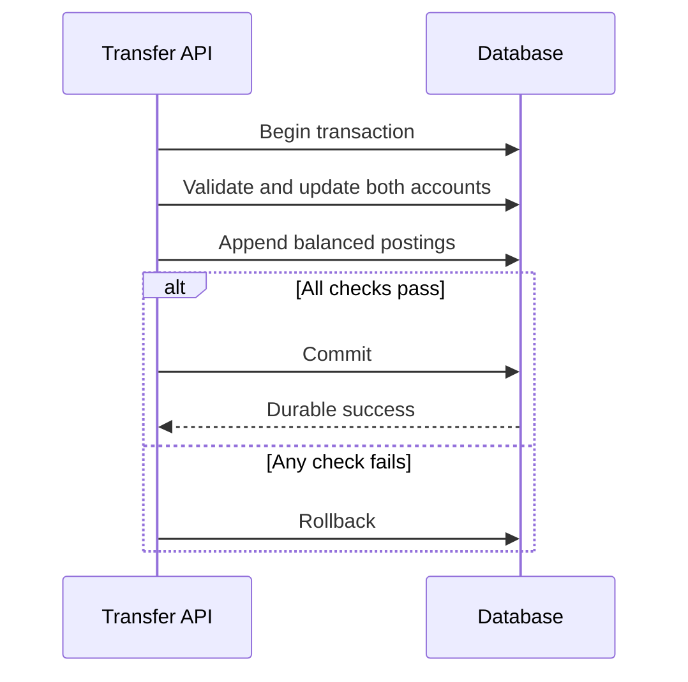

# 014 · Transactions and Atomic Business Changes

[Curriculum index](../../README.md) · [Track index](README.md)

## The problem

Money is deducted from one internal account, but a crash prevents crediting the other.

## Prerequisites

Before this session, review: [011](../../designs/02-data-and-storage/011-relational-data-modeling.md); invariants, commit and rollback.

If an item is unfamiliar, use the [starter glossary](../../START-HERE.md#starter-glossary) and linked earlier notes. You should be able to explain those items in your own words before moving to the worked approach.

## Predict first

What state must never be visible after recovery?

Write your answer and sketch the relevant state or request sequence before opening the solution.

Hint

Start with one normal operation, then pause it just before and just after its durable change. Identify who owns the truth and what another caller can observe. Use the question above to decide which assumption needs testing.

Worked approach — open after your attempt

## One workable approach

Within one transactional database, validate the transfer, lock or conditionally update the relevant balances, write both ledger entries, and commit as one transaction. If a step fails, roll back. Constraints protect invariants such as valid references and balanced entries. A transaction does not automatically include an external payment provider or message broker. Use explicit coordination patterns when crossing those boundaries.

## Flow or state sketch

Boxes represent responsibilities; they do not necessarily require separate deployable services. The text defines the guarantees and limitations.

## Trade-offs and limits

Long transactions hold resources and can increase contention. Keep external calls outside the transaction where possible and define how their outcomes are reconciled.

## Failure exercise

Crash between debit and credit before commit. Neither partial business change should remain committed.

Record the initial state, action sequence, expected durable state, and observed result. Explain the root cause of any mismatch before changing the design.

## 40-minute practice

| Time | Activity |
| --- | --- |
| 5 min | Recall the prerequisites without looking at the notes. |
| 10 min | Read the problem, predict the outcome, and sketch your approach. |
| 15 min | Draw the transaction boundary for an internal transfer and contrast it with charging an external card. |
| 5 min | Run or trace the failure exercise and improve the design. |
| 5 min | Explain your decision, one alternative, and one limitation aloud. |

## Explain and revisit

- What invariant or user promise are you protecting?
- Why does your chosen approach fit this problem?
- What evidence would make you change the design?

Record your attempt in the [practice log](../../PRACTICE-LOG.md). Revisit after 2–3 days and again after a week: redraw the flow and explain the failure without rereading first.

---

[Previous: 013](../../designs/02-data-and-storage/013-indexes-and-query-access-paths.md) · [Next: 015](../../designs/02-data-and-storage/015-isolation-levels-and-read-anomalies.md)
