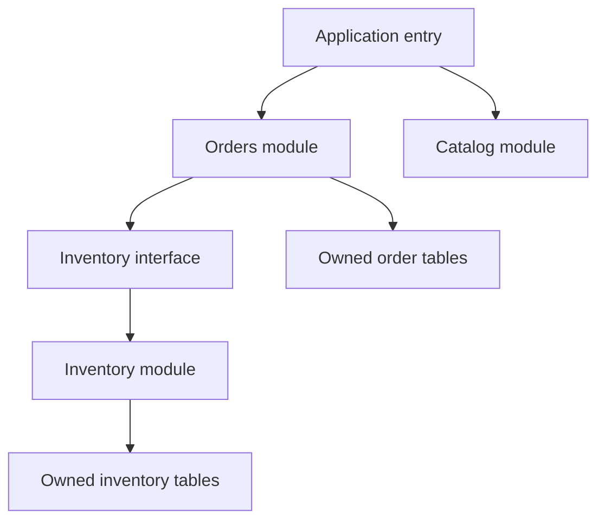

# 025 · Modular Monolith Design

[Curriculum index](../../README.md) · [Track index](README.md)

## The problem

A small team splits a new product into many services and spends more time deploying than delivering features.

## Prerequisites

Before this session, review: [011](../../designs/02-data-and-storage/011-relational-data-modeling.md),[021](../../designs/03-architecture-and-capacity/021-requirements-and-quality-attributes.md); modules, interfaces, transactions.

If an item is unfamiliar, use the [starter glossary](../../START-HERE.md#starter-glossary) and linked earlier notes. You should be able to explain those items in your own words before moving to the worked approach.

## Predict first

Which boundaries require separate deployment today?

Write your answer and sketch the relevant state or request sequence before opening the solution.

Hint

Start with one normal operation, then pause it just before and just after its durable change. Identify who owns the truth and what another caller can observe. Use the question above to decide which assumption needs testing.

Worked approach — open after your attempt

## One workable approach

Start with cohesive modules such as orders, inventory, and billing inside one deployable application. Define interfaces and data ownership so modules do not freely mutate each other's tables. Keep business rules close to their owning module and test boundaries. A shared process can simplify local calls and transactions while still enforcing architecture through code structure and reviews.

## Flow or state sketch

Boxes represent responsibilities; they do not necessarily require separate deployable services. The text defines the guarantees and limitations.

## Trade-offs and limits

A monolith is operationally simpler but can suffer tangled dependencies and whole-application releases. Modularity requires discipline; one deployable does not mean one undifferentiated codebase.

## Failure exercise

Change an inventory rule and inspect which modules and tests require changes.

Record the initial state, action sequence, expected durable state, and observed result. Explain the root cause of any mismatch before changing the design.

## 40-minute practice

| Time | Activity |
| --- | --- |
| 5 min | Recall the prerequisites without looking at the notes. |
| 10 min | Read the problem, predict the outcome, and sketch your approach. |
| 15 min | Sketch modules for a shop and specify which module owns each table and operation. |
| 5 min | Run or trace the failure exercise and improve the design. |
| 5 min | Explain your decision, one alternative, and one limitation aloud. |

## Explain and revisit

- What invariant or user promise are you protecting?
- Why does your chosen approach fit this problem?
- What evidence would make you change the design?

Record your attempt in the [practice log](../../PRACTICE-LOG.md). Revisit after 2–3 days and again after a week: redraw the flow and explain the failure without rereading first.

---

[Previous: 024](../../designs/03-architecture-and-capacity/024-tracing-a-request-through-the-network.md) · [Next: 026](../../designs/03-architecture-and-capacity/026-service-boundaries-and-microservice-extraction.md)
