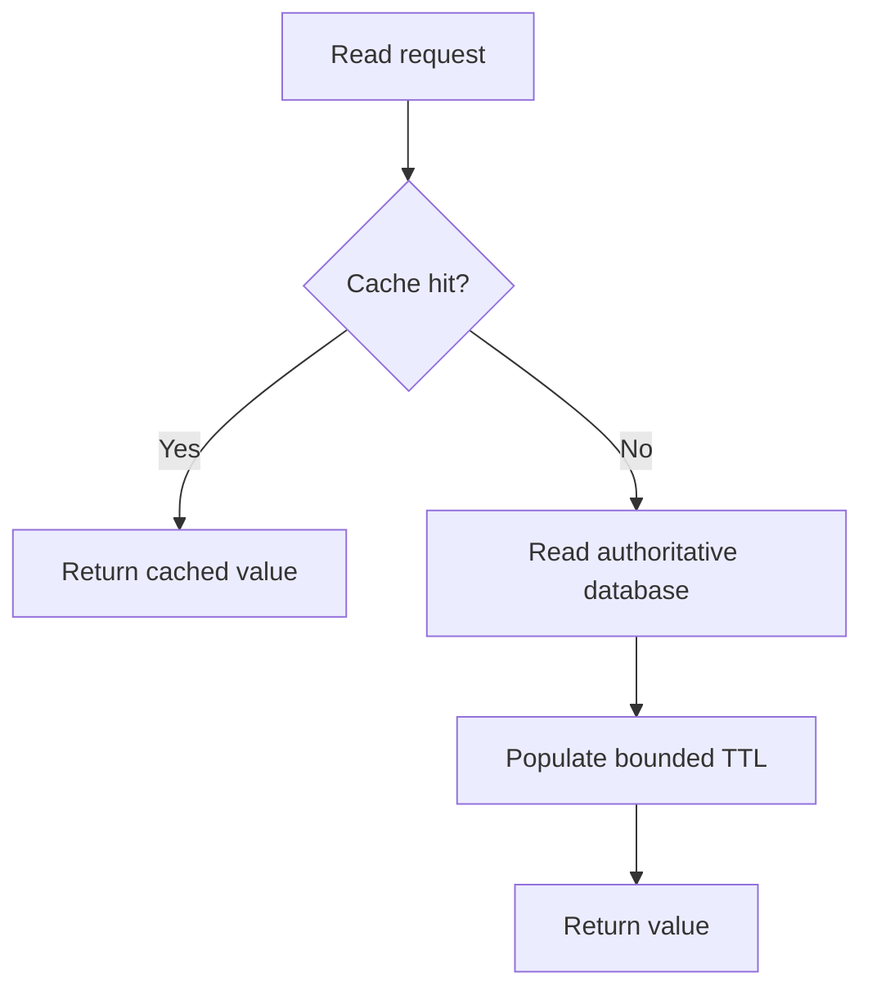

# 032 · Cache Aside Design

[Curriculum index](../../README.md) · [Track index](README.md)

## The problem

A product description is read thousands of times but changes only occasionally.

## Prerequisites

Before this session, review: [013](../../designs/02-data-and-storage/013-indexes-and-query-access-paths.md),[027](../../designs/03-architecture-and-capacity/027-stateless-compute-and-shared-state.md); cache keys, TTL, source of truth.

If an item is unfamiliar, use the [starter glossary](../../START-HERE.md#starter-glossary) and linked earlier notes. You should be able to explain those items in your own words before moving to the worked approach.

## Predict first

What should happen if the cache is empty or unavailable?

Write your answer and sketch the relevant state or request sequence before opening the solution.

Hint

Start with one normal operation, then pause it just before and just after its durable change. Identify who owns the truth and what another caller can observe. Use the question above to decide which assumption needs testing.

Worked approach — open after your attempt

## One workable approach

On a cache miss, read the authoritative database and optionally populate a bounded-lifetime cache entry. On a hit, serve the cached representation within the documented freshness tolerance. Include tenant, locale, and other response-changing inputs in the key. Put timeouts on cache access and protect the database from a flood of fallback reads. Cache failure should have a deliberate behavior, not an accidental one.

## Flow or state sketch

Boxes represent responsibilities; they do not necessarily require separate deployable services. The text defines the guarantees and limitations.

## Trade-offs and limits

Caching reduces repeated work but introduces staleness, memory cost, and another dependency. It does not fix an inherently expensive uncached path.

## Failure exercise

Delete all cache entries and measure database demand. Test that two tenants cannot share a private cache entry.

Record the initial state, action sequence, expected durable state, and observed result. Explain the root cause of any mismatch before changing the design.

## 40-minute practice

| Time | Activity |
| --- | --- |
| 5 min | Recall the prerequisites without looking at the notes. |
| 10 min | Read the problem, predict the outcome, and sketch your approach. |
| 15 min | Design cache keys and miss behavior for public product descriptions and private account balances. |
| 5 min | Run or trace the failure exercise and improve the design. |
| 5 min | Explain your decision, one alternative, and one limitation aloud. |

## Explain and revisit

- What invariant or user promise are you protecting?
- Why does your chosen approach fit this problem?
- What evidence would make you change the design?

Record your attempt in the [practice log](../../PRACTICE-LOG.md). Revisit after 2–3 days and again after a week: redraw the flow and explain the failure without rereading first.

---

[Previous: 031](../../designs/04-performance-and-scaling/031-load-balancing-and-health-checks.md) · [Next: 033](../../designs/04-performance-and-scaling/033-cache-invalidation-and-staleness.md)
