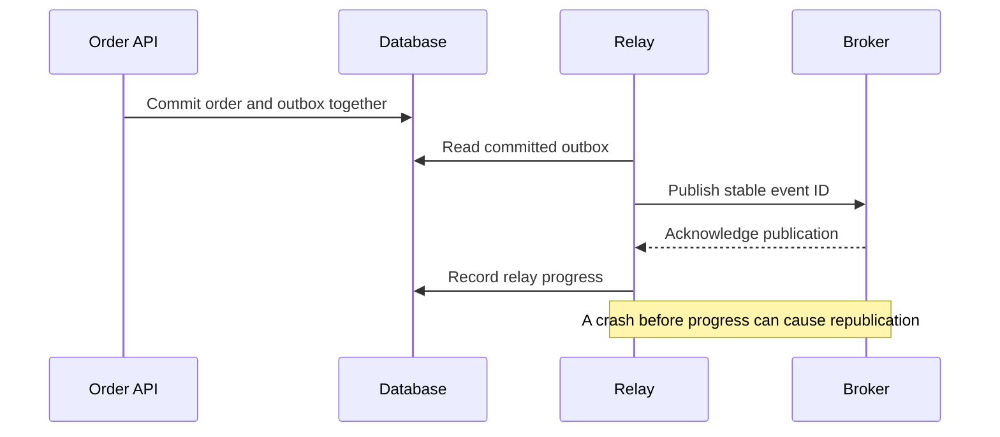

# 047 · Transactional Outbox

[Curriculum index](../../README.md) · [Track index](README.md)

## The problem

An order commits, but the process crashes before publishing OrderCreated.

## Prerequisites

Before this session, review: [014](../../designs/02-data-and-storage/014-transactions-and-atomic-business-changes.md),[041](../../designs/05-jobs-and-events/041-durable-job-queues-and-worker-acknowledgments.md),[044](../../designs/05-jobs-and-events/044-idempotency-keys-and-duplicate-requests.md); database transactions, asynchronous publishing.

If an item is unfamiliar, use the [starter glossary](../../START-HERE.md#starter-glossary) and linked earlier notes. You should be able to explain those items in your own words before moving to the worked approach.

## Predict first

Can a database commit and a separate broker publish be made atomic by calling them consecutively?

Write your answer and sketch the relevant state or request sequence before opening the solution.

Hint

Start with one normal operation, then pause it just before and just after its durable change. Identify who owns the truth and what another caller can observe. Use the question above to decide which assumption needs testing.

Worked approach — open after your attempt

## One workable approach

Write the order and an outbox event in the same database transaction. A relay reads committed outbox entries and publishes them, then records progress. A relay crash after publishing but before marking progress causes duplicate publication, so consumers deduplicate using a stable event ID. Keep per-entity ordering explicit and monitor outbox age. Retain enough history for recovery and clean up safely.

## Flow or state sketch

Boxes represent responsibilities; they do not necessarily require separate deployable services. The text defines the guarantees and limitations.

## Trade-offs and limits

The outbox removes the lost-event gap between the database change and event intent, but does not create exactly-once delivery. It adds relay operation and retention work.

## Failure exercise

Crash after order commit and after broker publication. Verify eventual delivery and one effective consumer update.

Record the initial state, action sequence, expected durable state, and observed result. Explain the root cause of any mismatch before changing the design.

## 40-minute practice

| Time | Activity |
| --- | --- |
| 5 min | Recall the prerequisites without looking at the notes. |
| 10 min | Read the problem, predict the outcome, and sketch your approach. |
| 15 min | Draw the transaction and relay boundaries, then identify every duplicate-delivery window. |
| 5 min | Run or trace the failure exercise and improve the design. |
| 5 min | Explain your decision, one alternative, and one limitation aloud. |

## Explain and revisit

- What invariant or user promise are you protecting?
- Why does your chosen approach fit this problem?
- What evidence would make you change the design?

Record your attempt in the [practice log](../../PRACTICE-LOG.md). Revisit after 2–3 days and again after a week: redraw the flow and explain the failure without rereading first.

---

[Previous: 046](../../designs/05-jobs-and-events/046-reliable-webhook-delivery.md) · [Next: 048](../../designs/05-jobs-and-events/048-event-ordering-and-partition-keys.md)
