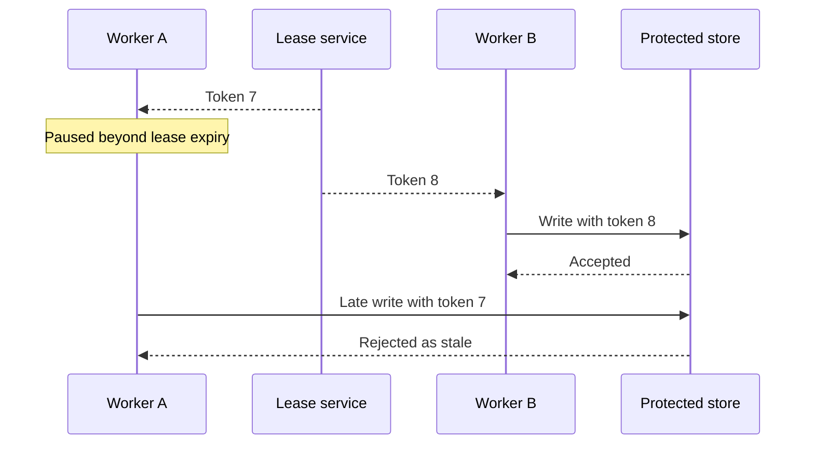

# 058 · Distributed Locks Leases and Fencing

[Curriculum index](../../README.md) · [Track index](README.md)

## The problem

A worker pauses, its lease expires, and a new worker starts; the old worker later resumes writing.

## Prerequisites

Before this session, review: [016](../../designs/02-data-and-storage/016-optimistic-and-pessimistic-concurrency.md),[042](../../designs/05-jobs-and-events/042-timeouts-deadlines-and-cancellation.md),[057](../../designs/06-distributed-systems/057-leader-election-and-consensus.md); lease expiry, paused processes.

If an item is unfamiliar, use the [starter glossary](../../START-HERE.md#starter-glossary) and linked earlier notes. You should be able to explain those items in your own words before moving to the worked approach.

## Predict first

Why does checking the lease once before work not protect later writes?

Write your answer and sketch the relevant state or request sequence before opening the solution.

Hint

Start with one normal operation, then pause it just before and just after its durable change. Identify who owns the truth and what another caller can observe. Use the question above to decide which assumption needs testing.

Worked approach — open after your attempt

## One workable approach

A lease grants temporary ownership, but pauses and delayed packets can outlive it. Issue monotonically increasing fencing tokens and require the protected resource to reject stale tokens. The resource must enforce ordering atomically; a token carried only in logs protects nothing. Prefer database constraints or transactions when they directly solve the invariant.

## Flow or state sketch

Boxes represent responsibilities; they do not necessarily require separate deployable services. The text defines the guarantees and limitations.

## Trade-offs and limits

Distributed locking adds a dependency and subtle failure cases. Fencing works only if the destination can enforce it; some external APIs cannot.

## Failure exercise

Pause worker A, let B acquire a newer token and write, then resume A.

Record the initial state, action sequence, expected durable state, and observed result. Explain the root cause of any mismatch before changing the design.

## 40-minute practice

| Time | Activity |
| --- | --- |
| 5 min | Recall the prerequisites without looking at the notes. |
| 10 min | Read the problem, predict the outcome, and sketch your approach. |
| 15 min | Design a write interface that rejects token 7 after token 8 has been accepted. |
| 5 min | Run or trace the failure exercise and improve the design. |
| 5 min | Explain your decision, one alternative, and one limitation aloud. |

## Explain and revisit

- What invariant or user promise are you protecting?
- Why does your chosen approach fit this problem?
- What evidence would make you change the design?

Record your attempt in the [practice log](../../PRACTICE-LOG.md). Revisit after 2–3 days and again after a week: redraw the flow and explain the failure without rereading first.

---

[Previous: 057](../../designs/06-distributed-systems/057-leader-election-and-consensus.md) · [Next: 059](../../designs/06-distributed-systems/059-distributed-ids-and-clock-behavior.md)
