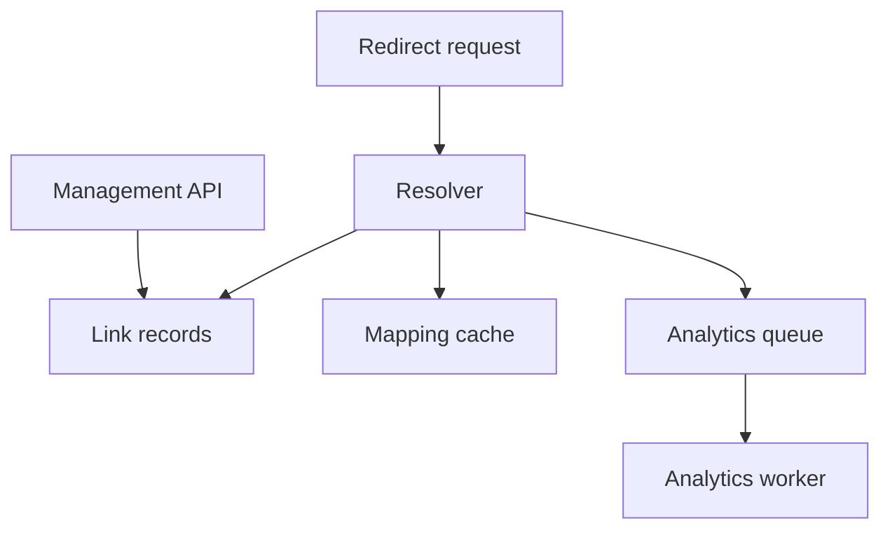

# 081 · URL Shortener

[Curriculum index](../../README.md) · [Track index](README.md)

## The problem

Design short links that redirect quickly while preventing unauthorized edits and abusive destinations.

## Prerequisites

Before this session, review: [002](../../designs/01-http-and-apis/002-rest-resource-and-endpoint-design.md),[013](../../designs/02-data-and-storage/013-indexes-and-query-access-paths.md),[032](../../designs/04-performance-and-scaling/032-cache-aside-design.md),[036](../../designs/04-performance-and-scaling/036-rate-limiting-and-quotas.md),[055](../../designs/06-distributed-systems/055-sharding-and-partition-key-selection.md),[059](../../designs/06-distributed-systems/059-distributed-ids-and-clock-behavior.md),[071](../../designs/08-security-and-multi-tenancy/071-authorization-and-object-ownership.md); redirects, unique keys.

If an item is unfamiliar, use the [starter glossary](../../START-HERE.md#starter-glossary) and linked earlier notes. You should be able to explain those items in your own words before moving to the worked approach.

## Predict first

Should popular redirect reads use the same path as link creation?

Write your answer and sketch the relevant state or request sequence before opening the solution.

Hint

Start with one normal operation, then pause it just before and just after its durable change. Identify who owns the truth and what another caller can observe. Use the question above to decide which assumption needs testing.

Worked approach — open after your attempt

## One workable approach

Separate link creation and management from the read-heavy redirect path. Store code, destination, owner, state, and optional expiry under a unique code constraint. Generate candidates and handle collisions explicitly. Cache eligible mappings and propagate disable operations with a stated maximum stale interval. Keep click analytics asynchronous so its failure does not block redirects. Validate destinations and provide abuse handling.

## Flow or state sketch

Boxes represent responsibilities; they do not necessarily require separate deployable services. The text defines the guarantees and limitations.

## Trade-offs and limits

Random codes reduce predictability but do not make a private link an authorization mechanism. Redirect status and browser caching affect whether later destination changes take effect.

## Failure exercise

Disable a popular link while caches are warm and measure how long redirects continue.

Record the initial state, action sequence, expected durable state, and observed result. Explain the root cause of any mismatch before changing the design.

## 40-minute practice

| Time | Activity |
| --- | --- |
| 5 min | Recall the prerequisites without looking at the notes. |
| 10 min | Read the problem, predict the outcome, and sketch your approach. |
| 15 min | Design create, resolve, disable, and statistics contracts plus a cache-invalidation timeline. |
| 5 min | Run or trace the failure exercise and improve the design. |
| 5 min | Explain your decision, one alternative, and one limitation aloud. |

This is a design session. A production implementation and its operational validation require additional sessions.

## Explain and revisit

- What invariant or user promise are you protecting?
- Why does your chosen approach fit this problem?
- What evidence would make you change the design?

Record your attempt in the [practice log](../../PRACTICE-LOG.md). Revisit after 2–3 days and again after a week: redraw the flow and explain the failure without rereading first.

---

[Previous: 080](../../designs/08-security-and-multi-tenancy/080-threat-modeling-and-security-design-review.md) · [Next: 082](../../designs/09-product-designs/082-notification-delivery-platform.md)
