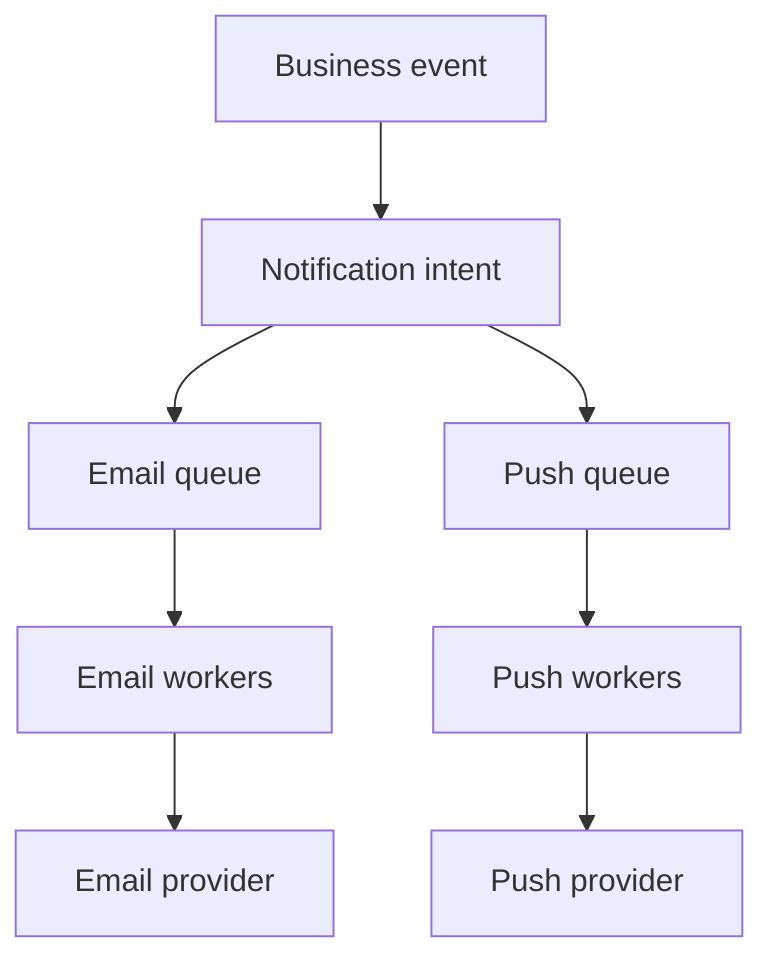

# 082 · Notification Delivery Platform

[Curriculum index](../../README.md) · [Track index](README.md)

## The problem

Send order notifications by email and push despite provider outages and duplicate events.

## Prerequisites

Before this session, review: [041](../../designs/05-jobs-and-events/041-durable-job-queues-and-worker-acknowledgments.md)–[048](../../designs/05-jobs-and-events/048-event-ordering-and-partition-keys.md),[061](../../designs/07-reliability-and-operations/061-logs-metrics-and-distributed-traces.md),[078](../../designs/08-security-and-multi-tenancy/078-abuse-prevention-and-resource-isolation.md); preferences, providers, delivery states.

If an item is unfamiliar, use the [starter glossary](../../START-HERE.md#starter-glossary) and linked earlier notes. You should be able to explain those items in your own words before moving to the worked approach.

## Predict first

Does provider acceptance prove the user saw the notification?

Write your answer and sketch the relevant state or request sequence before opening the solution.

Hint

Start with one normal operation, then pause it just before and just after its durable change. Identify who owns the truth and what another caller can observe. Use the question above to decide which assumption needs testing.

Worked approach — open after your attempt

## One workable approach

Persist notification intent with event ID, recipient, channel, template version, and policy checks. Separate channel queues and worker budgets. Deduplicate intents, retry transient provider failures, and track accepted, delivered where observable, and failed states distinctly. Apply preferences and suppression policies at an appropriate point so queued messages do not bypass changes. Reconcile uncertain provider outcomes.

## Flow or state sketch

Boxes represent responsibilities; they do not necessarily require separate deployable services. The text defines the guarantees and limitations.

## Trade-offs and limits

Channel isolation improves resilience but adds operations. Exactly-once visible delivery may be impossible without provider support; document the remaining duplicate window.

## Failure exercise

Lose the provider response after acceptance and verify retry behavior does not falsely claim certainty.

Record the initial state, action sequence, expected durable state, and observed result. Explain the root cause of any mismatch before changing the design.

## 40-minute practice

| Time | Activity |
| --- | --- |
| 5 min | Recall the prerequisites without looking at the notes. |
| 10 min | Read the problem, predict the outcome, and sketch your approach. |
| 15 min | Design notification states and a recovery policy for a one-hour provider outage. |
| 5 min | Run or trace the failure exercise and improve the design. |
| 5 min | Explain your decision, one alternative, and one limitation aloud. |

This is a design session. A production implementation and its operational validation require additional sessions.

## Explain and revisit

- What invariant or user promise are you protecting?
- Why does your chosen approach fit this problem?
- What evidence would make you change the design?

Record your attempt in the [practice log](../../PRACTICE-LOG.md). Revisit after 2–3 days and again after a week: redraw the flow and explain the failure without rereading first.

---

[Previous: 081](../../designs/09-product-designs/081-url-shortener.md) · [Next: 083](../../designs/09-product-designs/083-ticket-booking-and-seat-reservations.md)
