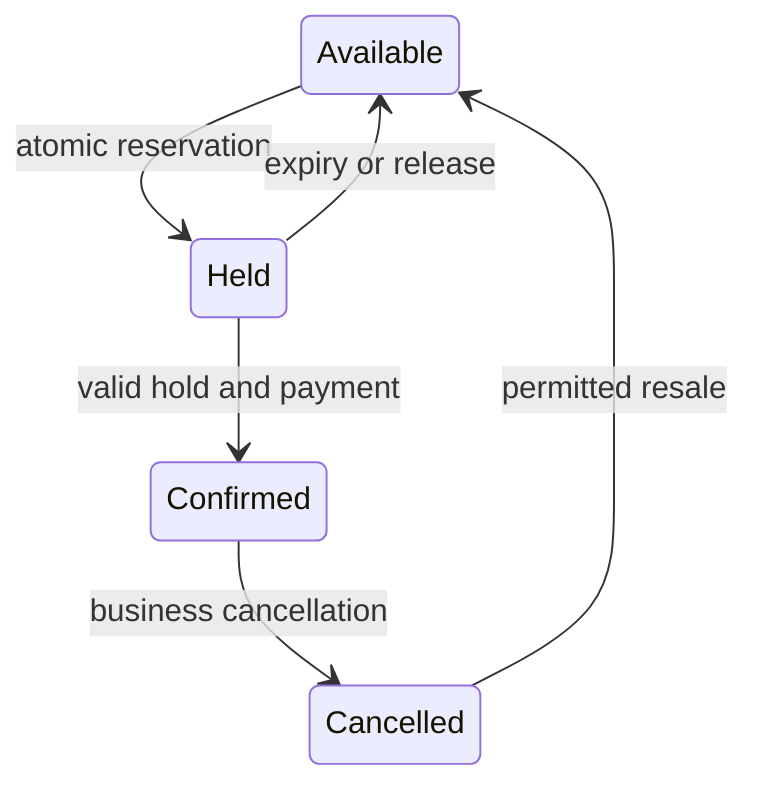

# 083 · Ticket Booking and Seat Reservations

[Curriculum index](../../README.md) · [Track index](README.md)

## The problem

Thousands of users try to reserve the same concert seats.

## Prerequisites

Before this session, review: [014](../../designs/02-data-and-storage/014-transactions-and-atomic-business-changes.md)–[016](../../designs/02-data-and-storage/016-optimistic-and-pessimistic-concurrency.md),[044](../../designs/05-jobs-and-events/044-idempotency-keys-and-duplicate-requests.md),[049](../../designs/05-jobs-and-events/049-sagas-and-compensating-actions.md),[058](../../designs/06-distributed-systems/058-distributed-locks-leases-and-fencing.md); expiry, payment outcomes.

If an item is unfamiliar, use the [starter glossary](../../START-HERE.md#starter-glossary) and linked earlier notes. You should be able to explain those items in your own words before moving to the worked approach.

## Predict first

Which durable condition prevents two confirmed owners of one seat?

Write your answer and sketch the relevant state or request sequence before opening the solution.

<details>
<summary>Hint</summary>

Start with one normal operation, then pause it just before and just after its durable change. Identify who owns the truth and what another caller can observe. Use the question above to decide which assumption needs testing.

</details>

<details>
<summary>Worked approach — open after your attempt</summary>

## One workable approach

Keep seat state under one authoritative transactional boundary. Atomically create a time-bounded hold only if the seat is available. Confirm ownership using a valid hold and recorded payment outcome; handle expiry and payment races with conditional transitions. Payment calls remain outside the database transaction and need idempotency and reconciliation. A cache can display availability but cannot award ownership.

## Flow or state sketch



Boxes represent responsibilities; they do not necessarily require separate deployable services. The text defines the guarantees and limitations.

## Concrete example

Illustrative pseudocode or contract, not a complete implementation.

```text
AVAILABLE -> HELD: conditional update with hold ID and expiry
HELD -> CONFIRMED: same live hold + known successful payment
HELD -> AVAILABLE: conditional expiry or release
late payment for lost hold -> reconcile and compensate per policy
```

## Trade-offs and limits

Strict coordination limits concurrency for a hot seat but protects the core invariant. A global distributed lock is often unnecessary when a database constraint and transaction can express the rule.

</details>

## Failure exercise

Race hold expiry against payment success and run two concurrent buyers for one seat.

Record the initial state, action sequence, expected durable state, and observed result. Explain the root cause of any mismatch before changing the design.

## 40-minute practice

| Time | Activity |
| --- | --- |
| 5 min | Recall the prerequisites without looking at the notes. |
| 10 min | Read the problem, predict the outcome, and sketch your approach. |
| 15 min | Write a seat state machine and specify the compensation when payment succeeds after a hold is lost. |
| 5 min | Run or trace the failure exercise and improve the design. |
| 5 min | Explain your decision, one alternative, and one limitation aloud. |

This is a design session. A production implementation and its operational validation require additional sessions.

## Explain and revisit

- What invariant or user promise are you protecting?
- Why does your chosen approach fit this problem?
- What evidence would make you change the design?

Record your attempt in the [practice log](../../PRACTICE-LOG.md). Revisit after 2–3 days and again after a week: redraw the flow and explain the failure without rereading first.

---

[Previous: 082](../../designs/09-product-designs/082-notification-delivery-platform.md) · [Next: 084](../../designs/09-product-designs/084-shopping-cart-and-checkout.md)
