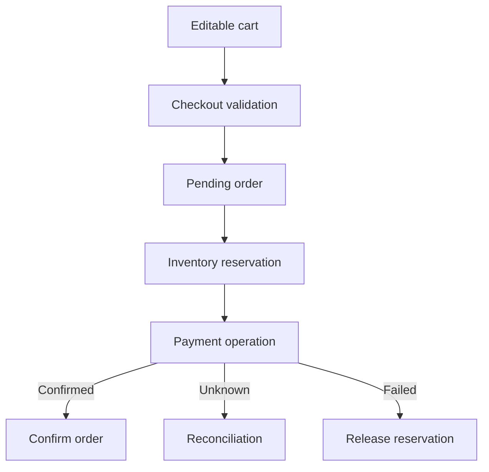

# 084 · Shopping Cart and Checkout

[Curriculum index](../../README.md) · [Track index](README.md)

## The problem

A cart price changes before checkout and a retry creates duplicate orders.

## Prerequisites

Before this session, review: [011](../../designs/02-data-and-storage/011-relational-data-modeling.md),[014](../../designs/02-data-and-storage/014-transactions-and-atomic-business-changes.md),[044](../../designs/05-jobs-and-events/044-idempotency-keys-and-duplicate-requests.md),[047](../../designs/05-jobs-and-events/047-transactional-outbox.md),[049](../../designs/05-jobs-and-events/049-sagas-and-compensating-actions.md); catalog snapshots, inventory.

If an item is unfamiliar, use the [starter glossary](../../START-HERE.md#starter-glossary) and linked earlier notes. You should be able to explain those items in your own words before moving to the worked approach.

## Predict first

Which values are estimates and which are committed purchase terms?

Write your answer and sketch the relevant state or request sequence before opening the solution.

Hint

Start with one normal operation, then pause it just before and just after its durable change. Identify who owns the truth and what another caller can observe. Use the question above to decide which assumption needs testing.

Worked approach — open after your attempt

## One workable approach

Treat the cart as editable intent. At checkout, validate current product state, price policy, stock, and shipping inputs. Create an order with immutable purchase snapshots and a stable operation ID. Coordinate inventory reservation and payment through explicit states. Emit committed order events through an outbox. Explain price changes before final confirmation and reconcile uncertain payments.

## Flow or state sketch

Boxes represent responsibilities; they do not necessarily require separate deployable services. The text defines the guarantees and limitations.

## Trade-offs and limits

Revalidating at checkout may surprise users but avoids treating stale cart data as authoritative. Holding stock for every abandoned cart wastes inventory.

## Failure exercise

Change price and stock while the cart is open; then lose the checkout response.

Record the initial state, action sequence, expected durable state, and observed result. Explain the root cause of any mismatch before changing the design.

## 40-minute practice

| Time | Activity |
| --- | --- |
| 5 min | Recall the prerequisites without looking at the notes. |
| 10 min | Read the problem, predict the outcome, and sketch your approach. |
| 15 min | Design cart, pending order, paid order, cancellation, and payment-unknown states. |
| 5 min | Run or trace the failure exercise and improve the design. |
| 5 min | Explain your decision, one alternative, and one limitation aloud. |

This is a design session. A production implementation and its operational validation require additional sessions.

## Explain and revisit

- What invariant or user promise are you protecting?
- Why does your chosen approach fit this problem?
- What evidence would make you change the design?

Record your attempt in the [practice log](../../PRACTICE-LOG.md). Revisit after 2–3 days and again after a week: redraw the flow and explain the failure without rereading first.

---

[Previous: 083](../../designs/09-product-designs/083-ticket-booking-and-seat-reservations.md) · [Next: 085](../../designs/09-product-designs/085-chat-and-offline-message-delivery.md)
