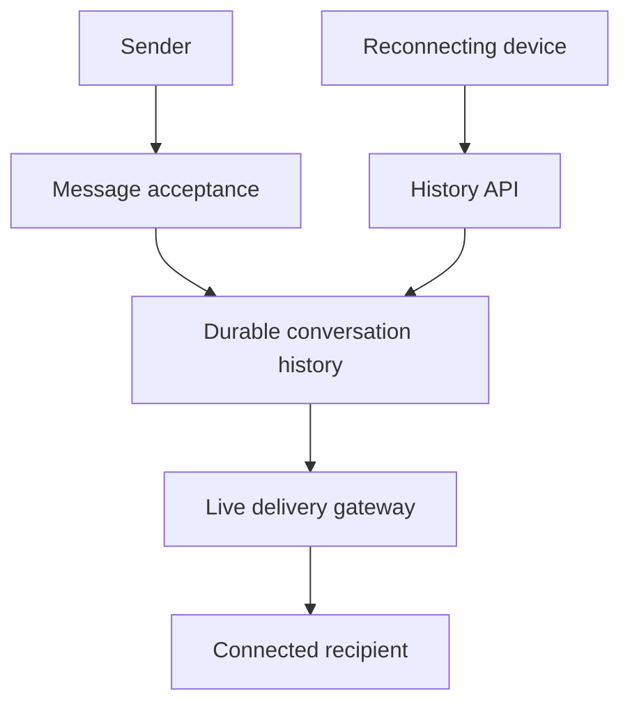

# 085 · Chat and Offline Message Delivery

[Curriculum index](../../README.md) · [Track index](README.md)

## The problem

Messages must reach users who temporarily disconnect without appearing twice.

## Prerequisites

Before this session, review: [029](../../designs/03-architecture-and-capacity/029-protocols-for-real-time-communication.md),[041](../../designs/05-jobs-and-events/041-durable-job-queues-and-worker-acknowledgments.md),[048](../../designs/05-jobs-and-events/048-event-ordering-and-partition-keys.md),[055](../../designs/06-distributed-systems/055-sharding-and-partition-key-selection.md),[071](../../designs/08-security-and-multi-tenancy/071-authorization-and-object-ownership.md); conversations, sequence numbers.

If an item is unfamiliar, use the [starter glossary](../../START-HERE.md#starter-glossary) and linked earlier notes. You should be able to explain those items in your own words before moving to the worked approach.

## Predict first

Is a successful socket send enough to mark a message durably accepted?

Write your answer and sketch the relevant state or request sequence before opening the solution.

Hint

Start with one normal operation, then pause it just before and just after its durable change. Identify who owns the truth and what another caller can observe. Use the question above to decide which assumption needs testing.

Worked approach — open after your attempt

## One workable approach

Persist messages with a client-generated deduplication ID and a server-assigned conversation position before acknowledging acceptance. Route live delivery through gateways, but recover offline gaps from durable history. Track device or user cursors according to the product semantics. Enforce membership on sends and history reads. Distinguish accepted, delivered-to-device, and read states; none implies the others automatically.

## Flow or state sketch

Boxes represent responsibilities; they do not necessarily require separate deployable services. The text defines the guarantees and limitations.

## Trade-offs and limits

Per-conversation ordering simplifies history but can make large conversations hot. Presence is ephemeral and should not be mistaken for durable delivery evidence.

## Failure exercise

Disconnect after persistence but before acknowledgment, resend, and recover the missed range.

Record the initial state, action sequence, expected durable state, and observed result. Explain the root cause of any mismatch before changing the design.

## 40-minute practice

| Time | Activity |
| --- | --- |
| 5 min | Recall the prerequisites without looking at the notes. |
| 10 min | Read the problem, predict the outcome, and sketch your approach. |
| 15 min | Design message acceptance and reconnect-resume protocols for two devices belonging to one user. |
| 5 min | Run or trace the failure exercise and improve the design. |
| 5 min | Explain your decision, one alternative, and one limitation aloud. |

This is a design session. A production implementation and its operational validation require additional sessions.

## Explain and revisit

- What invariant or user promise are you protecting?
- Why does your chosen approach fit this problem?
- What evidence would make you change the design?

Record your attempt in the [practice log](../../PRACTICE-LOG.md). Revisit after 2–3 days and again after a week: redraw the flow and explain the failure without rereading first.

---

[Previous: 084](../../designs/09-product-designs/084-shopping-cart-and-checkout.md) · [Next: 086](../../designs/09-product-designs/086-file-sharing-and-resumable-uploads.md)
