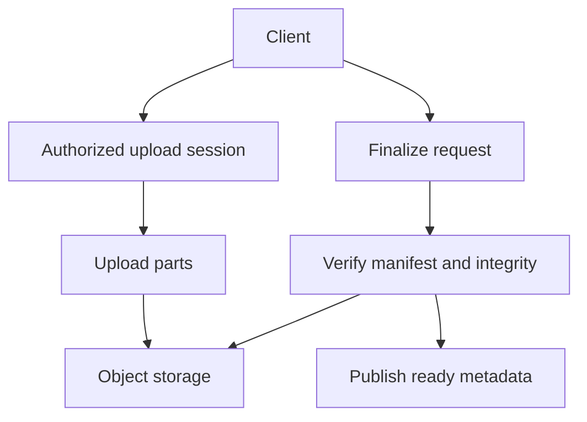

# 086 · File Sharing and Resumable Uploads

[Curriculum index](../../README.md) · [Track index](README.md)

## The problem

A large upload fails near completion and users should resume without resending everything.

## Prerequisites

Before this session, review: [018](../../designs/02-data-and-storage/018-object-storage-and-metadata-design.md)–[019](../../designs/02-data-and-storage/019-data-retention-archival-and-deletion.md),[044](../../designs/05-jobs-and-events/044-idempotency-keys-and-duplicate-requests.md),[071](../../designs/08-security-and-multi-tenancy/071-authorization-and-object-ownership.md)–[072](../../designs/08-security-and-multi-tenancy/072-multi-tenant-data-isolation.md); chunks, checksums, ownership.

If an item is unfamiliar, use the [starter glossary](../../START-HERE.md#starter-glossary) and linked earlier notes. You should be able to explain those items in your own words before moving to the worked approach.

## Predict first

What proves all chunks belong to the intended completed file?

Write your answer and sketch the relevant state or request sequence before opening the solution.

Hint

Start with one normal operation, then pause it just before and just after its durable change. Identify who owns the truth and what another caller can observe. Use the question above to decide which assumption needs testing.

Worked approach — open after your attempt

## One workable approach

Create an authorized upload session with expected size, object identity, and expiry. Upload numbered parts with integrity checks using constrained capabilities. Finalize only when the expected part set and complete-object checks pass; publish ready metadata after required validation. Make finalization idempotent. Separate access grants from object identifiers and clean abandoned sessions and parts.

## Flow or state sketch

Boxes represent responsibilities; they do not necessarily require separate deployable services. The text defines the guarantees and limitations.

## Trade-offs and limits

Chunking improves recovery but adds manifests, cleanup, and validation. Deduplication by content hash must not expose another user's file or bypass access controls.

## Failure exercise

Repeat a part, omit one, send an incorrect checksum, and finalize twice.

Record the initial state, action sequence, expected durable state, and observed result. Explain the root cause of any mismatch before changing the design.

## 40-minute practice

| Time | Activity |
| --- | --- |
| 5 min | Recall the prerequisites without looking at the notes. |
| 10 min | Read the problem, predict the outcome, and sketch your approach. |
| 15 min | Design upload status, part retry, finalization, sharing revocation, and orphan cleanup. |
| 5 min | Run or trace the failure exercise and improve the design. |
| 5 min | Explain your decision, one alternative, and one limitation aloud. |

This is a design session. A production implementation and its operational validation require additional sessions.

## Explain and revisit

- What invariant or user promise are you protecting?
- Why does your chosen approach fit this problem?
- What evidence would make you change the design?

Record your attempt in the [practice log](../../PRACTICE-LOG.md). Revisit after 2–3 days and again after a week: redraw the flow and explain the failure without rereading first.

---

[Previous: 085](../../designs/09-product-designs/085-chat-and-offline-message-delivery.md) · [Next: 087](../../designs/09-product-designs/087-product-search-and-index-synchronization.md)
