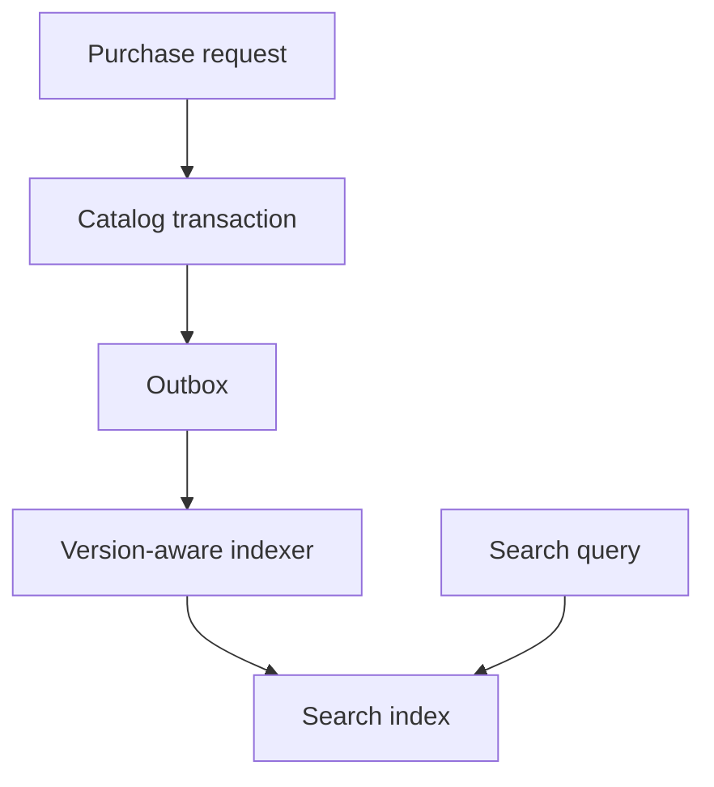

# 087 · Product Search and Index Synchronization

[Curriculum index](../../README.md) · [Track index](README.md)

## The problem

Search shows deleted products and stale prices after catalog updates.

## Prerequisites

Before this session, review: [020](../../designs/02-data-and-storage/020-read-models-and-materialized-views.md),[047](../../designs/05-jobs-and-events/047-transactional-outbox.md)–[048](../../designs/05-jobs-and-events/048-event-ordering-and-partition-keys.md),[071](../../designs/08-security-and-multi-tenancy/071-authorization-and-object-ownership.md); indexing, source versions.

If an item is unfamiliar, use the [starter glossary](../../START-HERE.md#starter-glossary) and linked earlier notes. You should be able to explain those items in your own words before moving to the worked approach.

## Predict first

Should the search index authorize a purchase?

Write your answer and sketch the relevant state or request sequence before opening the solution.

Hint

Start with one normal operation, then pause it just before and just after its durable change. Identify who owns the truth and what another caller can observe. Use the question above to decide which assumption needs testing.

Worked approach — open after your attempt

## One workable approach

Keep catalog records authoritative and feed committed changes to a derived search index. Include entity version and deletion markers so out-of-order updates cannot resurrect old state. Define freshness objectives and monitor indexing lag. Rebuild into a new index, catch up changes, validate, then switch readers. Revalidate purchase-sensitive fields against the authoritative service.

## Flow or state sketch

Boxes represent responsibilities; they do not necessarily require separate deployable services. The text defines the guarantees and limitations.

## Trade-offs and limits

Search indexes optimize retrieval and ranking but are often eventually consistent. More immediate updates cost throughput and coordination; correctness checks should not rely on search freshness.

## Failure exercise

Deliver an old update after a deletion and rebuild while new changes arrive.

Record the initial state, action sequence, expected durable state, and observed result. Explain the root cause of any mismatch before changing the design.

## 40-minute practice

| Time | Activity |
| --- | --- |
| 5 min | Recall the prerequisites without looking at the notes. |
| 10 min | Read the problem, predict the outcome, and sketch your approach. |
| 15 min | Design incremental indexing and a zero-gap rebuild/cutover procedure. |
| 5 min | Run or trace the failure exercise and improve the design. |
| 5 min | Explain your decision, one alternative, and one limitation aloud. |

This is a design session. A production implementation and its operational validation require additional sessions.

## Explain and revisit

- What invariant or user promise are you protecting?
- Why does your chosen approach fit this problem?
- What evidence would make you change the design?

Record your attempt in the [practice log](../../PRACTICE-LOG.md). Revisit after 2–3 days and again after a week: redraw the flow and explain the failure without rereading first.

---

[Previous: 086](../../designs/09-product-designs/086-file-sharing-and-resumable-uploads.md) · [Next: 088](../../designs/09-product-designs/088-social-feed-and-fan-out.md)
