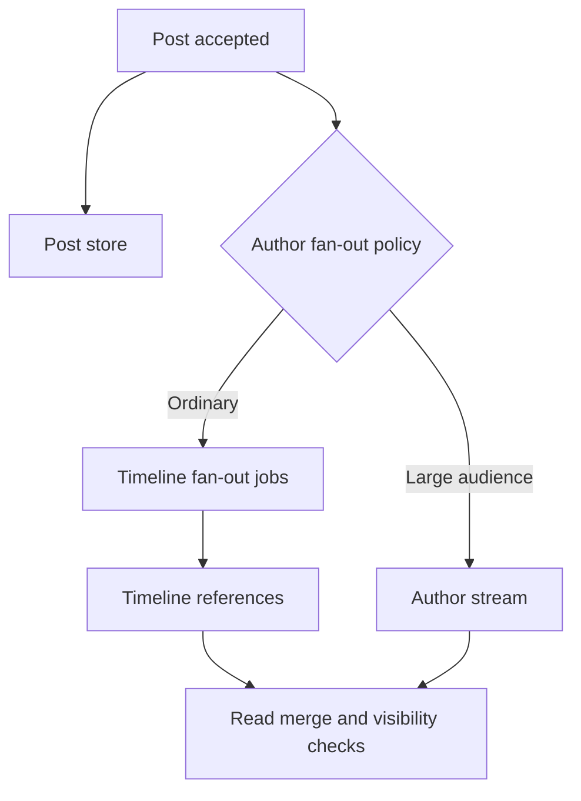

# 088 · Social Feed and Fan Out

[Curriculum index](../../README.md) · [Track index](README.md)

## The problem

A celebrity post has millions of followers while ordinary users have only a few.

## Prerequisites

Before this session, review: [020](../../designs/02-data-and-storage/020-read-models-and-materialized-views.md),[032](../../designs/04-performance-and-scaling/032-cache-aside-design.md),[041](../../designs/05-jobs-and-events/041-durable-job-queues-and-worker-acknowledgments.md),[055](../../designs/06-distributed-systems/055-sharding-and-partition-key-selection.md),[078](../../designs/08-security-and-multi-tenancy/078-abuse-prevention-and-resource-isolation.md); followers, timelines, access rules.

If an item is unfamiliar, use the [starter glossary](../../START-HERE.md#starter-glossary) and linked earlier notes. You should be able to explain those items in your own words before moving to the worked approach.

## Predict first

Should every post be copied into every follower's inbox immediately?

Write your answer and sketch the relevant state or request sequence before opening the solution.

Hint

Start with one normal operation, then pause it just before and just after its durable change. Identify who owns the truth and what another caller can observe. Use the question above to decide which assumption needs testing.

Worked approach — open after your attempt

## One workable approach

Compare fan-out-on-write with fan-out-on-read and use a hybrid when follower distributions justify it. Store posts authoritatively; maintain bounded timeline references rather than duplicating full objects everywhere. Merge sources using stable pagination and apply current visibility rules. Propagate deletes and blocks. Separate durable post acceptance from eventual feed appearance.

## Flow or state sketch

Boxes represent responsibilities; they do not necessarily require separate deployable services. The text defines the guarantees and limitations.

## Trade-offs and limits

Write fan-out makes reads cheap but creates enormous work for popular authors. Read fan-out avoids that write burst but increases read aggregation cost.

## Failure exercise

Publish from a very large account, then delete the post and block a follower.

Record the initial state, action sequence, expected durable state, and observed result. Explain the root cause of any mismatch before changing the design.

## 40-minute practice

| Time | Activity |
| --- | --- |
| 5 min | Recall the prerequisites without looking at the notes. |
| 10 min | Read the problem, predict the outcome, and sketch your approach. |
| 15 min | Choose a fan-out threshold from assumed workloads and describe private-post visibility enforcement. |
| 5 min | Run or trace the failure exercise and improve the design. |
| 5 min | Explain your decision, one alternative, and one limitation aloud. |

This is a design session. A production implementation and its operational validation require additional sessions.

## Explain and revisit

- What invariant or user promise are you protecting?
- Why does your chosen approach fit this problem?
- What evidence would make you change the design?

Record your attempt in the [practice log](../../PRACTICE-LOG.md). Revisit after 2–3 days and again after a week: redraw the flow and explain the failure without rereading first.

---

[Previous: 087](../../designs/09-product-designs/087-product-search-and-index-synchronization.md) · [Next: 089](../../designs/09-product-designs/089-location-based-nearby-search.md)
