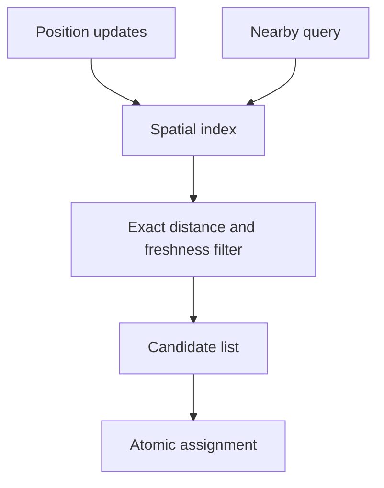

# 089 · Location Based Nearby Search

[Curriculum index](../../README.md) · [Track index](README.md)

## The problem

A delivery app needs nearby couriers whose positions change frequently.

## Prerequisites

Before this session, review: [013](../../designs/02-data-and-storage/013-indexes-and-query-access-paths.md),[022](../../designs/03-architecture-and-capacity/022-traffic-and-storage-estimation.md),[055](../../designs/06-distributed-systems/055-sharding-and-partition-key-selection.md),[071](../../designs/08-security-and-multi-tenancy/071-authorization-and-object-ownership.md),[079](../../designs/08-security-and-multi-tenancy/079-privacy-deletion-and-data-minimization.md); coordinates, distance, freshness.

If an item is unfamiliar, use the [starter glossary](../../START-HERE.md#starter-glossary) and linked earlier notes. You should be able to explain those items in your own words before moving to the worked approach.

## Predict first

Does being in the same map cell imply being within the requested radius?

Write your answer and sketch the relevant state or request sequence before opening the solution.

Hint

Start with one normal operation, then pause it just before and just after its durable change. Identify who owns the truth and what another caller can observe. Use the question above to decide which assumption needs testing.

Worked approach — open after your attempt

## One workable approach

Index positions by a suitable spatial structure or geographic cell, retrieve candidate cells including boundaries, then compute exact distance for final filtering. Include update time and expiry so stale couriers do not look available. Separate discovery from assignment, which must atomically claim the courier or job. Protect location history with narrow access and retention.

## Flow or state sketch

Boxes represent responsibilities; they do not necessarily require separate deployable services. The text defines the guarantees and limitations.

## Trade-offs and limits

Coarser cells reduce index overhead but increase false candidates; finer cells increase update and boundary work. Position freshness has a bandwidth and battery cost.

## Failure exercise

Place users near cell boundaries and expire a courier during assignment.

Record the initial state, action sequence, expected durable state, and observed result. Explain the root cause of any mismatch before changing the design.

## 40-minute practice

| Time | Activity |
| --- | --- |
| 5 min | Recall the prerequisites without looking at the notes. |
| 10 min | Read the problem, predict the outcome, and sketch your approach. |
| 15 min | Design candidate retrieval, distance filtering, stale-location handling, and assignment concurrency. |
| 5 min | Run or trace the failure exercise and improve the design. |
| 5 min | Explain your decision, one alternative, and one limitation aloud. |

This is a design session. A production implementation and its operational validation require additional sessions.

## Explain and revisit

- What invariant or user promise are you protecting?
- Why does your chosen approach fit this problem?
- What evidence would make you change the design?

Record your attempt in the [practice log](../../PRACTICE-LOG.md). Revisit after 2–3 days and again after a week: redraw the flow and explain the failure without rereading first.

---

[Previous: 088](../../designs/09-product-designs/088-social-feed-and-fan-out.md) · [Next: 090](../../designs/09-product-designs/090-scheduled-jobs-and-distributed-cron.md)
