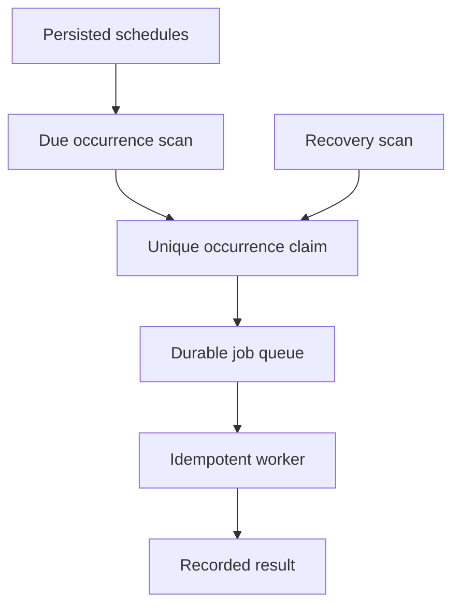

# 090 · Scheduled Jobs and Distributed Cron

[Curriculum index](../../README.md) · [Track index](README.md)

## The problem

Two scheduler instances fire the same daily job, and a restart misses another run.

## Prerequisites

Before this session, review: [041](../../designs/05-jobs-and-events/041-durable-job-queues-and-worker-acknowledgments.md),[044](../../designs/05-jobs-and-events/044-idempotency-keys-and-duplicate-requests.md),[048](../../designs/05-jobs-and-events/048-event-ordering-and-partition-keys.md),[058](../../designs/06-distributed-systems/058-distributed-locks-leases-and-fencing.md); calendars, leases, timezones.

If an item is unfamiliar, use the [starter glossary](../../START-HERE.md#starter-glossary) and linked earlier notes. You should be able to explain those items in your own words before moving to the worked approach.

## Predict first

What uniquely identifies one scheduled occurrence?

Write your answer and sketch the relevant state or request sequence before opening the solution.

Hint

Start with one normal operation, then pause it just before and just after its durable change. Identify who owns the truth and what another caller can observe. Use the question above to decide which assumption needs testing.

Worked approach — open after your attempt

## One workable approach

Persist schedules and derive occurrence IDs from schedule identity and intended run time under a documented timezone policy. Atomically claim or create each occurrence, enqueue recoverable work, and use idempotent workers. Define missed-run handling, catch-up limits, daylight-saving behavior, edits, and cancellation. Leases recover scheduling ownership but do not alone prevent duplicate effects.

## Flow or state sketch

Boxes represent responsibilities; they do not necessarily require separate deployable services. The text defines the guarantees and limitations.

## Trade-offs and limits

Catch-up preserves intended work but can cause bursts after outages. Skipping missed runs is simpler only if the business agrees.

## Failure exercise

Restart around the scheduled instant and simulate a repeated or missing local clock hour.

Record the initial state, action sequence, expected durable state, and observed result. Explain the root cause of any mismatch before changing the design.

## 40-minute practice

| Time | Activity |
| --- | --- |
| 5 min | Recall the prerequisites without looking at the notes. |
| 10 min | Read the problem, predict the outcome, and sketch your approach. |
| 15 min | Design occurrence identity and policy for a daily report after six hours of downtime. |
| 5 min | Run or trace the failure exercise and improve the design. |
| 5 min | Explain your decision, one alternative, and one limitation aloud. |

This is a design session. A production implementation and its operational validation require additional sessions.

## Explain and revisit

- What invariant or user promise are you protecting?
- Why does your chosen approach fit this problem?
- What evidence would make you change the design?

Record your attempt in the [practice log](../../PRACTICE-LOG.md). Revisit after 2–3 days and again after a week: redraw the flow and explain the failure without rereading first.

---

[Previous: 089](../../designs/09-product-designs/089-location-based-nearby-search.md) · [Next: 091](../../designs/10-advanced-case-studies/091-multi-region-order-processing.md)
