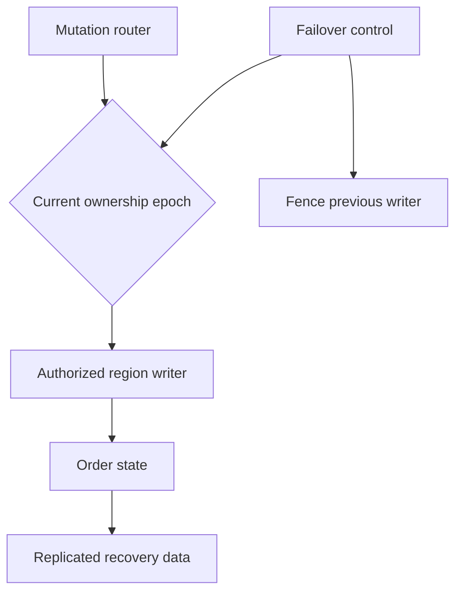

# 091 · Multi Region Order Processing

[Curriculum index](../../README.md) · [Track index](README.md)

## The problem

Customers need service during a regional outage without creating conflicting order histories.

## Prerequisites

Before this session, review: [049](../../designs/05-jobs-and-events/049-sagas-and-compensating-actions.md),[051](../../designs/06-distributed-systems/051-replication-and-failover.md)–[060](../../designs/06-distributed-systems/060-cross-region-data-and-conflict-resolution.md),[067](../../designs/07-reliability-and-operations/067-backups-restore-and-disaster-recovery.md); regional ownership, recovery.

If an item is unfamiliar, use the [starter glossary](../../START-HERE.md#starter-glossary) and linked earlier notes. You should be able to explain those items in your own words before moving to the worked approach.

## Predict first

Which region may mutate an order after failover?

Write your answer and sketch the relevant state or request sequence before opening the solution.

Hint

Start with one normal operation, then pause it just before and just after its durable change. Identify who owns the truth and what another caller can observe. Use the question above to decide which assumption needs testing.

Worked approach — open after your attempt

## One workable approach

Assign each order an authoritative home or use a proven globally coordinated store for the required invariants. Replicate data according to recovery targets, route mutations to the owner, and use a controlled ownership epoch during failover. Fence the previous writer before promoting another. Keep independent browsing available where possible. Reconcile uncertain payment and inventory effects after recovery.

## Flow or state sketch

Boxes represent responsibilities; they do not necessarily require separate deployable services. The text defines the guarantees and limitations.

## Trade-offs and limits

Local reads can improve latency, but globally safe writes require coordination or explicit ownership. Active-active marketing language does not eliminate split-brain risk.

## Failure exercise

Partition the old primary region and attempt writes before and after ownership transfer.

Record the initial state, action sequence, expected durable state, and observed result. Explain the root cause of any mismatch before changing the design.

## 40-minute practice

| Time | Activity |
| --- | --- |
| 5 min | Recall the prerequisites without looking at the notes. |
| 10 min | Read the problem, predict the outcome, and sketch your approach. |
| 15 min | Define failover preconditions, permitted degraded operations, and failback verification. |
| 5 min | Run or trace the failure exercise and improve the design. |
| 5 min | Explain your decision, one alternative, and one limitation aloud. |

This is a design session. A production implementation and its operational validation require additional sessions.

## Explain and revisit

- What invariant or user promise are you protecting?
- Why does your chosen approach fit this problem?
- What evidence would make you change the design?

Record your attempt in the [practice log](../../PRACTICE-LOG.md). Revisit after 2–3 days and again after a week: redraw the flow and explain the failure without rereading first.

---

[Previous: 090](../../designs/09-product-designs/090-scheduled-jobs-and-distributed-cron.md) · [Next: 092](../../designs/10-advanced-case-studies/092-payment-ledger-and-reconciliation.md)
