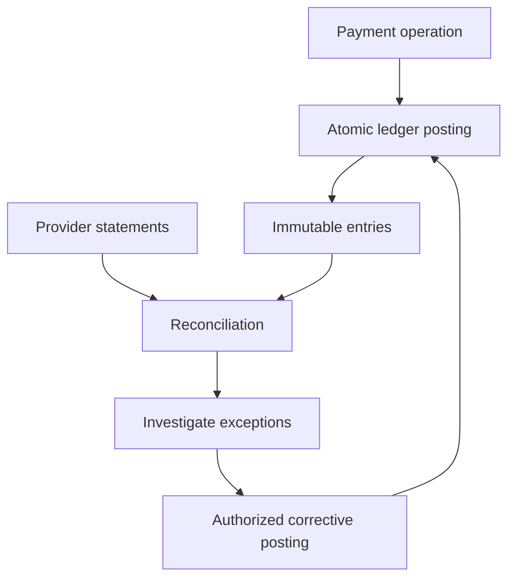

# 092 · Payment Ledger and Reconciliation

[Curriculum index](../../README.md) · [Track index](README.md)

## The problem

Payment-provider callbacks disagree with internal balances after retries and delayed settlement.

## Prerequisites

Before this session, review: [011](../../designs/02-data-and-storage/011-relational-data-modeling.md),[014](../../designs/02-data-and-storage/014-transactions-and-atomic-business-changes.md)–[016](../../designs/02-data-and-storage/016-optimistic-and-pessimistic-concurrency.md),[044](../../designs/05-jobs-and-events/044-idempotency-keys-and-duplicate-requests.md),[047](../../designs/05-jobs-and-events/047-transactional-outbox.md),[076](../../designs/08-security-and-multi-tenancy/076-audit-trails-and-tamper-evidence.md); exact arithmetic, external settlement.

If an item is unfamiliar, use the [starter glossary](../../START-HERE.md#starter-glossary) and linked earlier notes. You should be able to explain those items in your own words before moving to the worked approach.

## Predict first

Which records explain the balance instead of merely storing a mutable number?

Write your answer and sketch the relevant state or request sequence before opening the solution.

Hint

Start with one normal operation, then pause it just before and just after its durable change. Identify who owns the truth and what another caller can observe. Use the question above to decide which assumption needs testing.

Worked approach — open after your attempt

## One workable approach

Record immutable balanced ledger postings in exact units with explicit currency. Enforce unique business-operation identity and atomic posting rules. Represent corrections as new entries. Keep provider transaction IDs and reconcile internal records with provider statements, accounting for pending, settled, reversed, and disputed states. A balanced ledger can still contain the wrong business transaction, so reconciliation and authorization remain necessary.

## Flow or state sketch

Boxes represent responsibilities; they do not necessarily require separate deployable services. The text defines the guarantees and limitations.

## Trade-offs and limits

An append-only ledger improves traceability but requires careful account semantics and operational controls. Do not use binary floating-point for monetary accounting.

## Failure exercise

Replay a callback, omit a settlement event, and compare ledger totals with provider records.

Record the initial state, action sequence, expected durable state, and observed result. Explain the root cause of any mismatch before changing the design.

## 40-minute practice

| Time | Activity |
| --- | --- |
| 5 min | Recall the prerequisites without looking at the notes. |
| 10 min | Read the problem, predict the outcome, and sketch your approach. |
| 15 min | Design accounts and postings for a charge, fee, refund, and reconciliation exception. |
| 5 min | Run or trace the failure exercise and improve the design. |
| 5 min | Explain your decision, one alternative, and one limitation aloud. |

This is a design session. A production implementation and its operational validation require additional sessions.

## Explain and revisit

- What invariant or user promise are you protecting?
- Why does your chosen approach fit this problem?
- What evidence would make you change the design?

Record your attempt in the [practice log](../../PRACTICE-LOG.md). Revisit after 2–3 days and again after a week: redraw the flow and explain the failure without rereading first.

---

[Previous: 091](../../designs/10-advanced-case-studies/091-multi-region-order-processing.md) · [Next: 093](../../designs/10-advanced-case-studies/093-live-video-streaming-delivery.md)
