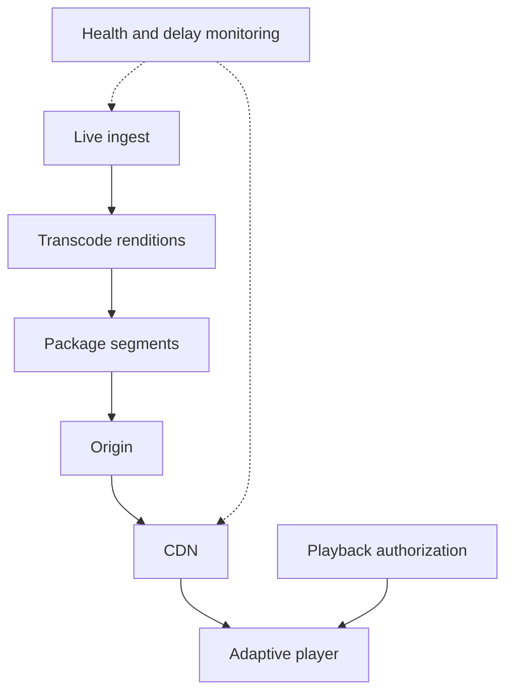

# 093 · Live Video Streaming Delivery

[Curriculum index](../../README.md) · [Track index](README.md)

## The problem

A live event attracts a sudden audience surge and viewers experience buffering.

## Prerequisites

Before this session, review: [018](../../designs/02-data-and-storage/018-object-storage-and-metadata-design.md),[022](../../designs/03-architecture-and-capacity/022-traffic-and-storage-estimation.md),[035](../../designs/04-performance-and-scaling/035-content-delivery-networks.md),[039](../../designs/04-performance-and-scaling/039-backpressure-and-load-shedding.md),[061](../../designs/07-reliability-and-operations/061-logs-metrics-and-distributed-traces.md); media segments, bitrate, buffers.

If an item is unfamiliar, use the [starter glossary](../../START-HERE.md#starter-glossary) and linked earlier notes. You should be able to explain those items in your own words before moving to the worked approach.

## Predict first

Which stages contribute to end-to-end live delay?

Write your answer and sketch the relevant state or request sequence before opening the solution.

Hint

Start with one normal operation, then pause it just before and just after its durable change. Identify who owns the truth and what another caller can observe. Use the question above to decide which assumption needs testing.

Worked approach — open after your attempt

## One workable approach

Separate ingest, transcoding, packaging, origin storage, and edge delivery. Produce multiple bitrate renditions and manifests so clients can adapt to network conditions. Use CDN distribution for shared media segments and monitor ingest health, segment publication delay, cache hit ratio, and rebuffering. Authorize playback according to the product while protecting the origin from bypass traffic.

## Flow or state sketch

Boxes represent responsibilities; they do not necessarily require separate deployable services. The text defines the guarantees and limitations.

## Trade-offs and limits

Shorter segments and smaller buffers reduce delay but increase request overhead and sensitivity to jitter. More renditions cost compute and storage.

## Failure exercise

Lose one ingest path and overload the origin while checking playback recovery and latency.

Record the initial state, action sequence, expected durable state, and observed result. Explain the root cause of any mismatch before changing the design.

## 40-minute practice

| Time | Activity |
| --- | --- |
| 5 min | Recall the prerequisites without looking at the notes. |
| 10 min | Read the problem, predict the outcome, and sketch your approach. |
| 15 min | Budget latency across capture, encoding, segmenting, distribution, and player buffering. |
| 5 min | Run or trace the failure exercise and improve the design. |
| 5 min | Explain your decision, one alternative, and one limitation aloud. |

This is a design session. A production implementation and its operational validation require additional sessions.

## Explain and revisit

- What invariant or user promise are you protecting?
- Why does your chosen approach fit this problem?
- What evidence would make you change the design?

Record your attempt in the [practice log](../../PRACTICE-LOG.md). Revisit after 2–3 days and again after a week: redraw the flow and explain the failure without rereading first.

---

[Previous: 092](../../designs/10-advanced-case-studies/092-payment-ledger-and-reconciliation.md) · [Next: 094](../../designs/10-advanced-case-studies/094-collaborative-document-editing.md)
