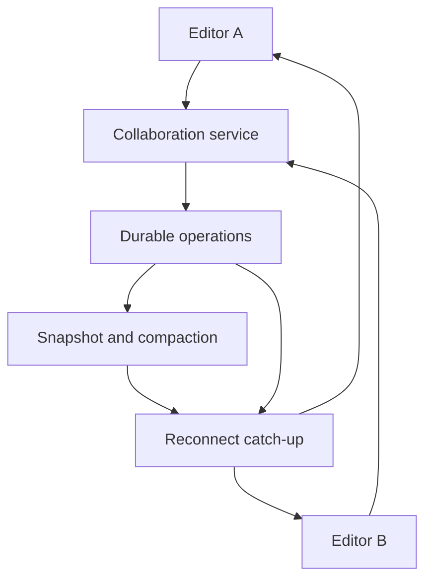

# 094 · Collaborative Document Editing

[Curriculum index](../../README.md) · [Track index](README.md)

## The problem

Two people insert text at the same position while one is offline.

## Prerequisites

Before this session, review: [029](../../designs/03-architecture-and-capacity/029-protocols-for-real-time-communication.md),[048](../../designs/05-jobs-and-events/048-event-ordering-and-partition-keys.md),[052](../../designs/06-distributed-systems/052-consistency-models-and-user-guarantees.md),[059](../../designs/06-distributed-systems/059-distributed-ids-and-clock-behavior.md),[071](../../designs/08-security-and-multi-tenancy/071-authorization-and-object-ownership.md); concurrent edits, operation identity.

If an item is unfamiliar, use the [starter glossary](../../START-HERE.md#starter-glossary) and linked earlier notes. You should be able to explain those items in your own words before moving to the worked approach.

## Predict first

Why does applying edits in arrival order produce different documents on different clients?

Write your answer and sketch the relevant state or request sequence before opening the solution.

Hint

Start with one normal operation, then pause it just before and just after its durable change. Identify who owns the truth and what another caller can observe. Use the question above to decide which assumption needs testing.

Worked approach — open after your attempt

## One workable approach

Choose an established operational transformation or CRDT approach appropriate to the editing model. Represent edits with stable identities and enough ordering or causal information for the chosen algorithm. Persist operations or authoritative state, deduplicate retransmissions, and support snapshots plus catch-up. Enforce document access on connection and operations; revoke access deliberately. Cursor presence can remain ephemeral.

## Flow or state sketch

Boxes represent responsibilities; they do not necessarily require separate deployable services. The text defines the guarantees and limitations.

## Trade-offs and limits

Collaboration algorithms are substantially more complex than broadcasting strings. Rich-text structures, undo, compaction, and offline edits need explicit semantics and mature libraries.

## Failure exercise

Apply concurrent inserts in different arrival orders and verify convergence under the selected algorithm.

Record the initial state, action sequence, expected durable state, and observed result. Explain the root cause of any mismatch before changing the design.

## 40-minute practice

| Time | Activity |
| --- | --- |
| 5 min | Recall the prerequisites without looking at the notes. |
| 10 min | Read the problem, predict the outcome, and sketch your approach. |
| 15 min | Specify offline reconnect, duplicate operations, undo expectations, and permission revocation behavior. |
| 5 min | Run or trace the failure exercise and improve the design. |
| 5 min | Explain your decision, one alternative, and one limitation aloud. |

This is a design session. A production implementation and its operational validation require additional sessions.

## Explain and revisit

- What invariant or user promise are you protecting?
- Why does your chosen approach fit this problem?
- What evidence would make you change the design?

Record your attempt in the [practice log](../../PRACTICE-LOG.md). Revisit after 2–3 days and again after a week: redraw the flow and explain the failure without rereading first.

---

[Previous: 093](../../designs/10-advanced-case-studies/093-live-video-streaming-delivery.md) · [Next: 095](../../designs/10-advanced-case-studies/095-distributed-web-crawler.md)
