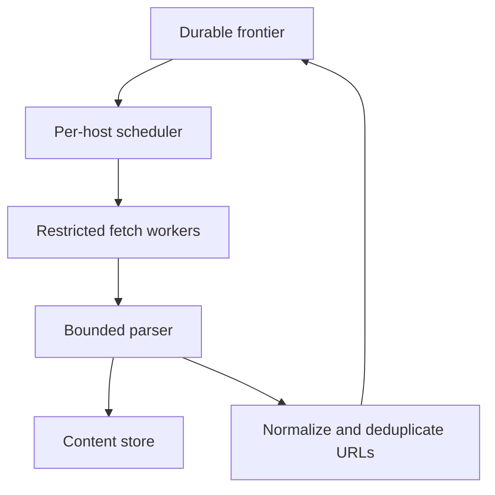

# 095 · Distributed Web Crawler

[Curriculum index](../../README.md) · [Track index](README.md)

## The problem

A crawler repeatedly visits equivalent URLs and overwhelms one host.

## Prerequisites

Before this session, review: [041](../../designs/05-jobs-and-events/041-durable-job-queues-and-worker-acknowledgments.md),[044](../../designs/05-jobs-and-events/044-idempotency-keys-and-duplicate-requests.md),[055](../../designs/06-distributed-systems/055-sharding-and-partition-key-selection.md),[077](../../designs/08-security-and-multi-tenancy/077-input-trust-boundaries-and-ssrf-defense.md)–[079](../../designs/08-security-and-multi-tenancy/079-privacy-deletion-and-data-minimization.md); URLs, parsing, fetch limits.

If an item is unfamiliar, use the [starter glossary](../../START-HERE.md#starter-glossary) and linked earlier notes. You should be able to explain those items in your own words before moving to the worked approach.

## Predict first

How can global parallelism coexist with per-host politeness?

Write your answer and sketch the relevant state or request sequence before opening the solution.

Hint

Start with one normal operation, then pause it just before and just after its durable change. Identify who owns the truth and what another caller can observe. Use the question above to decide which assumption needs testing.

Worked approach — open after your attempt

## One workable approach

Maintain a durable frontier with URL normalization and deduplication rules. Schedule with per-host concurrency and delays, obey applicable crawl policies, and bound redirects, bytes, parsing work, and retries. Treat fetched content and destinations as hostile. Separate fetching from extraction and storage. Checkpoint progress and track content freshness for recrawls.

## Flow or state sketch

Boxes represent responsibilities; they do not necessarily require separate deployable services. The text defines the guarantees and limitations.

## Trade-offs and limits

Aggressive normalization can merge distinct resources; weak normalization wastes work. High throughput requires careful host fairness rather than simply adding workers.

## Failure exercise

Create redirect loops, huge pages, duplicate URLs, and a slow host.

Record the initial state, action sequence, expected durable state, and observed result. Explain the root cause of any mismatch before changing the design.

## 40-minute practice

| Time | Activity |
| --- | --- |
| 5 min | Recall the prerequisites without looking at the notes. |
| 10 min | Read the problem, predict the outcome, and sketch your approach. |
| 15 min | Design frontier states and per-host scheduling while preventing internal-network access. |
| 5 min | Run or trace the failure exercise and improve the design. |
| 5 min | Explain your decision, one alternative, and one limitation aloud. |

This is a design session. A production implementation and its operational validation require additional sessions.

## Explain and revisit

- What invariant or user promise are you protecting?
- Why does your chosen approach fit this problem?
- What evidence would make you change the design?

Record your attempt in the [practice log](../../PRACTICE-LOG.md). Revisit after 2–3 days and again after a week: redraw the flow and explain the failure without rereading first.

---

[Previous: 094](../../designs/10-advanced-case-studies/094-collaborative-document-editing.md) · [Next: 096](../../designs/10-advanced-case-studies/096-metrics-ingestion-and-time-series-storage.md)
