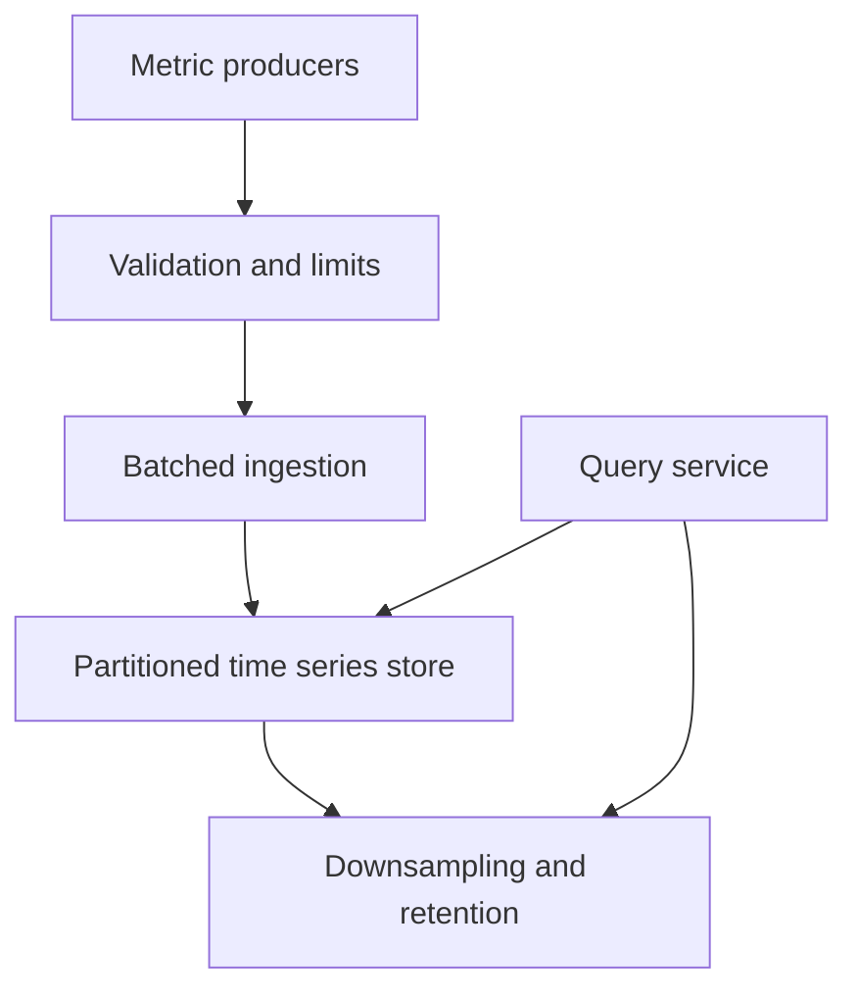

# 096 · Metrics Ingestion and Time Series Storage

[Curriculum index](../../README.md) · [Track index](README.md)

## The problem

Millions of time series arrive, and a user-ID label causes cardinality to explode.

## Prerequisites

Before this session, review: [022](../../designs/03-architecture-and-capacity/022-traffic-and-storage-estimation.md),[041](../../designs/05-jobs-and-events/041-durable-job-queues-and-worker-acknowledgments.md),[055](../../designs/06-distributed-systems/055-sharding-and-partition-key-selection.md),[061](../../designs/07-reliability-and-operations/061-logs-metrics-and-distributed-traces.md),[078](../../designs/08-security-and-multi-tenancy/078-abuse-prevention-and-resource-isolation.md); timestamps, labels, aggregation.

If an item is unfamiliar, use the [starter glossary](../../START-HERE.md#starter-glossary) and linked earlier notes. You should be able to explain those items in your own words before moving to the worked approach.

## Predict first

Why can small individual samples still create enormous indexing cost?

Write your answer and sketch the relevant state or request sequence before opening the solution.

Hint

Start with one normal operation, then pause it just before and just after its durable change. Identify who owns the truth and what another caller can observe. Use the question above to decide which assumption needs testing.

Worked approach — open after your attempt

## One workable approach

Validate and batch ingestion, partition by a chosen series/time strategy, and enforce limits on series count and label cardinality. Define out-of-order and duplicate-sample handling. Store recent data at needed resolution and downsample or expire older data according to query requirements. Separate ingestion health from query load and expose dropped-sample counters.

## Flow or state sketch

Boxes represent responsibilities; they do not necessarily require separate deployable services. The text defines the guarantees and limitations.

## Trade-offs and limits

Downsampling lowers cost but loses detail. Aggregating percentiles by averaging precomputed percentiles is generally invalid; retain mergeable distributions when cross-group quantiles are needed.

## Failure exercise

Send high-cardinality labels, late samples, and duplicate batches while measuring memory and query behavior.

Record the initial state, action sequence, expected durable state, and observed result. Explain the root cause of any mismatch before changing the design.

## 40-minute practice

| Time | Activity |
| --- | --- |
| 5 min | Recall the prerequisites without looking at the notes. |
| 10 min | Read the problem, predict the outcome, and sketch your approach. |
| 15 min | Design retention tiers and an ingestion overload policy for service metrics. |
| 5 min | Run or trace the failure exercise and improve the design. |
| 5 min | Explain your decision, one alternative, and one limitation aloud. |

This is a design session. A production implementation and its operational validation require additional sessions.

## Explain and revisit

- What invariant or user promise are you protecting?
- Why does your chosen approach fit this problem?
- What evidence would make you change the design?

Record your attempt in the [practice log](../../PRACTICE-LOG.md). Revisit after 2–3 days and again after a week: redraw the flow and explain the failure without rereading first.

---

[Previous: 095](../../designs/10-advanced-case-studies/095-distributed-web-crawler.md) · [Next: 097](../../designs/10-advanced-case-studies/097-distributed-task-scheduler.md)
