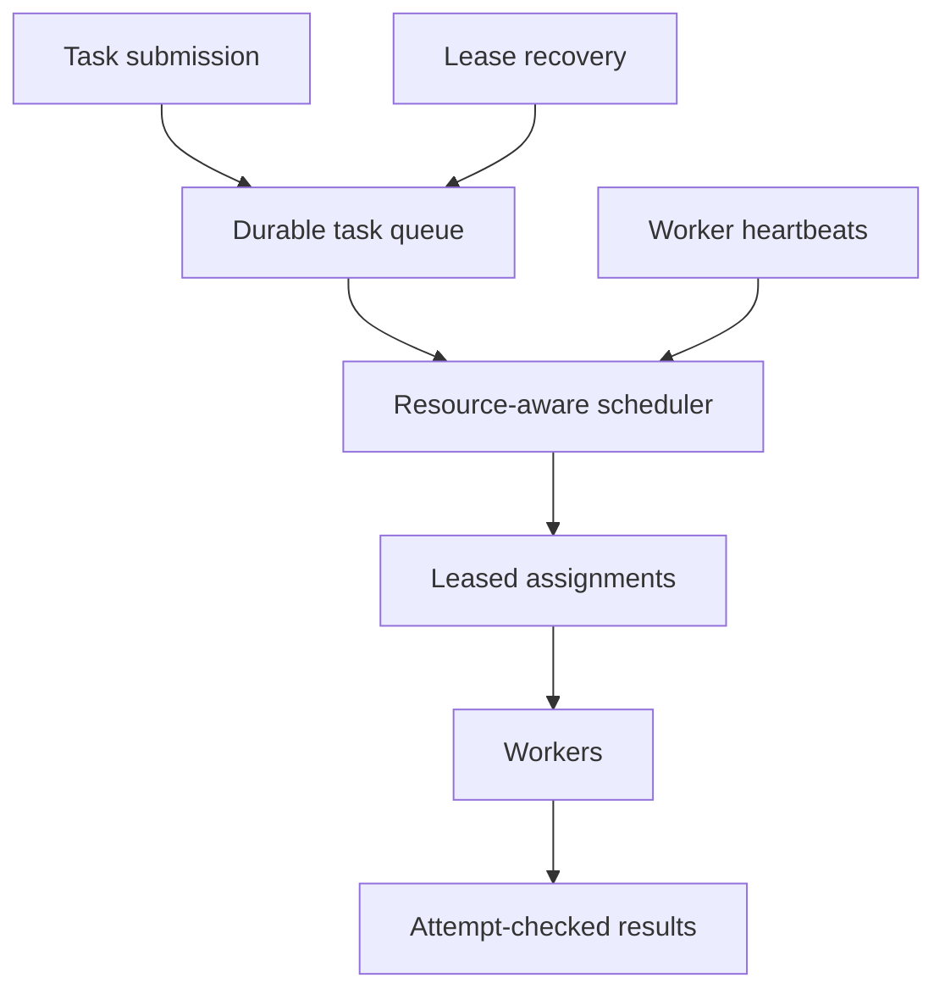

# 097 · Distributed Task Scheduler

[Curriculum index](../../README.md) · [Track index](README.md)

## The problem

Jobs compete for CPU and memory across workers, and some tasks remain stuck after worker crashes.

## Prerequisites

Before this session, review: [037](../../designs/04-performance-and-scaling/037-autoscaling-and-capacity-headroom.md)–[039](../../designs/04-performance-and-scaling/039-backpressure-and-load-shedding.md),[041](../../designs/05-jobs-and-events/041-durable-job-queues-and-worker-acknowledgments.md),[055](../../designs/06-distributed-systems/055-sharding-and-partition-key-selection.md),[058](../../designs/06-distributed-systems/058-distributed-locks-leases-and-fencing.md),[078](../../designs/08-security-and-multi-tenancy/078-abuse-prevention-and-resource-isolation.md); resource requirements, leases.

If an item is unfamiliar, use the [starter glossary](../../START-HERE.md#starter-glossary) and linked earlier notes. You should be able to explain those items in your own words before moving to the worked approach.

## Predict first

What makes a task eligible for a particular worker?

Write your answer and sketch the relevant state or request sequence before opening the solution.

Hint

Start with one normal operation, then pause it just before and just after its durable change. Identify who owns the truth and what another caller can observe. Use the question above to decide which assumption needs testing.

Worked approach — open after your attempt

## One workable approach

Persist task requirements and lifecycle state. Match tasks to available resources with fairness and priority rules, then assign leases and attempt identities. Recover expired assignments, but use fencing or idempotent effects to handle old workers that resume. Bound retries and separate permanently unschedulable tasks from temporarily queued work. Track queue age by class.

## Flow or state sketch

Boxes represent responsibilities; they do not necessarily require separate deployable services. The text defines the guarantees and limitations.

## Trade-offs and limits

Packing resources tightly improves utilization but may reduce fairness or increase scheduling complexity. Preemption requires checkpoint or restart semantics and is not free.

## Failure exercise

Lose a worker mid-task and allow its process to reappear after reassignment.

Record the initial state, action sequence, expected durable state, and observed result. Explain the root cause of any mismatch before changing the design.

## 40-minute practice

| Time | Activity |
| --- | --- |
| 5 min | Recall the prerequisites without looking at the notes. |
| 10 min | Read the problem, predict the outcome, and sketch your approach. |
| 15 min | Design task states, worker heartbeats, placement constraints, and stale-result rejection. |
| 5 min | Run or trace the failure exercise and improve the design. |
| 5 min | Explain your decision, one alternative, and one limitation aloud. |

This is a design session. A production implementation and its operational validation require additional sessions.

## Explain and revisit

- What invariant or user promise are you protecting?
- Why does your chosen approach fit this problem?
- What evidence would make you change the design?

Record your attempt in the [practice log](../../PRACTICE-LOG.md). Revisit after 2–3 days and again after a week: redraw the flow and explain the failure without rereading first.

---

[Previous: 096](../../designs/10-advanced-case-studies/096-metrics-ingestion-and-time-series-storage.md) · [Next: 098](../../designs/10-advanced-case-studies/098-inventory-reservation-across-warehouses.md)
