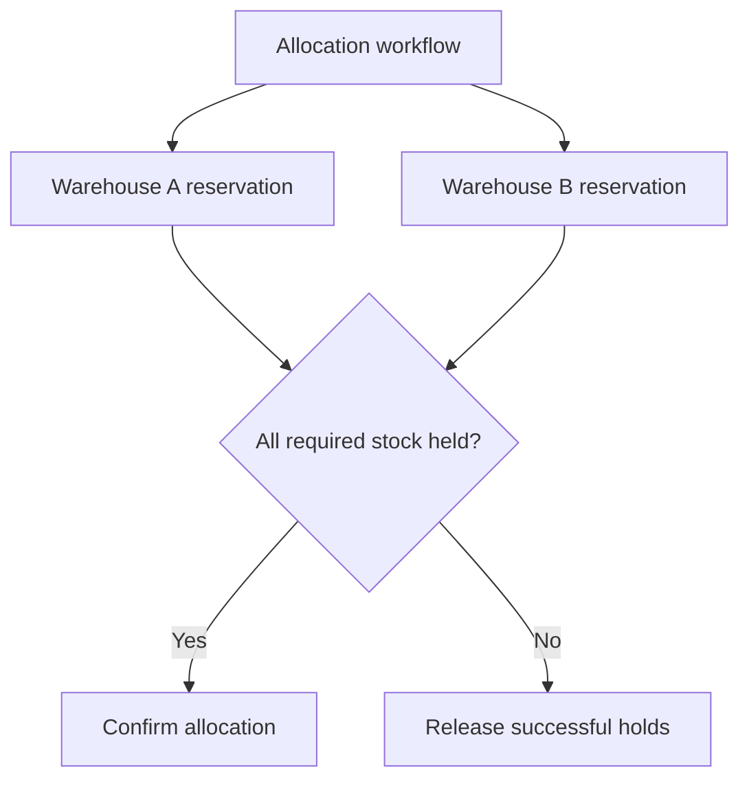

# 098 · Inventory Reservation across Warehouses

[Curriculum index](../../README.md) · [Track index](README.md)

## The problem

An order needs stock from multiple warehouses and one reservation fails.

## Prerequisites

Before this session, review: [016](../../designs/02-data-and-storage/016-optimistic-and-pessimistic-concurrency.md),[044](../../designs/05-jobs-and-events/044-idempotency-keys-and-duplicate-requests.md),[049](../../designs/05-jobs-and-events/049-sagas-and-compensating-actions.md),[055](../../designs/06-distributed-systems/055-sharding-and-partition-key-selection.md),[060](../../designs/06-distributed-systems/060-cross-region-data-and-conflict-resolution.md); reservations, allocation, expiry.

If an item is unfamiliar, use the [starter glossary](../../START-HERE.md#starter-glossary) and linked earlier notes. You should be able to explain those items in your own words before moving to the worked approach.

## Predict first

Can a global displayed total safely authorize each warehouse reservation?

Write your answer and sketch the relevant state or request sequence before opening the solution.

Hint

Start with one normal operation, then pause it just before and just after its durable change. Identify who owns the truth and what another caller can observe. Use the question above to decide which assumption needs testing.

Worked approach — open after your attempt

## One workable approach

Keep authoritative available stock and reservations at the chosen warehouse or SKU boundary. Use conditional reservation operations with stable IDs and explicit expiry. Coordinate multi-warehouse allocation as a workflow with partial states and release actions. Reconcile shipping, cancellation, and expiry races. Aggregated stock is useful for discovery but final allocation must check authoritative owners.

## Flow or state sketch

Boxes represent responsibilities; they do not necessarily require separate deployable services. The text defines the guarantees and limitations.

## Trade-offs and limits

Central coordination simplifies some invariants but may increase latency. Distributed reservations improve locality while creating partial-success and compensation cases.

## Failure exercise

Reserve at warehouse A, fail at B, then retry after A's hold expires.

Record the initial state, action sequence, expected durable state, and observed result. Explain the root cause of any mismatch before changing the design.

## 40-minute practice

| Time | Activity |
| --- | --- |
| 5 min | Recall the prerequisites without looking at the notes. |
| 10 min | Read the problem, predict the outcome, and sketch your approach. |
| 15 min | Design allocation, partial failure, compensation, and late shipment confirmation rules. |
| 5 min | Run or trace the failure exercise and improve the design. |
| 5 min | Explain your decision, one alternative, and one limitation aloud. |

This is a design session. A production implementation and its operational validation require additional sessions.

## Explain and revisit

- What invariant or user promise are you protecting?
- Why does your chosen approach fit this problem?
- What evidence would make you change the design?

Record your attempt in the [practice log](../../PRACTICE-LOG.md). Revisit after 2–3 days and again after a week: redraw the flow and explain the failure without rereading first.

---

[Previous: 097](../../designs/10-advanced-case-studies/097-distributed-task-scheduler.md) · [Next: 099](../../designs/10-advanced-case-studies/099-large-scale-data-migration-and-cutover.md)
