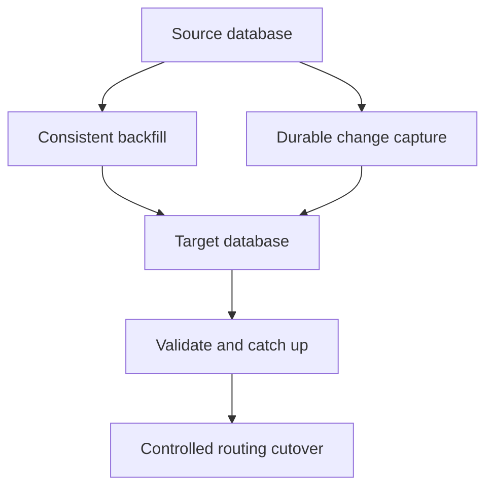

# 099 · Large Scale Data Migration and Cutover

[Curriculum index](../../README.md) · [Track index](README.md)

## The problem

A database must move while new writes continue, without losing changes.

## Prerequisites

Before this session, review: [017](../../designs/02-data-and-storage/017-schema-migrations-without-downtime.md),[020](../../designs/02-data-and-storage/020-read-models-and-materialized-views.md),[047](../../designs/05-jobs-and-events/047-transactional-outbox.md)–[048](../../designs/05-jobs-and-events/048-event-ordering-and-partition-keys.md),[055](../../designs/06-distributed-systems/055-sharding-and-partition-key-selection.md),[064](../../designs/07-reliability-and-operations/064-rolling-canary-and-blue-green-deployments.md),[067](../../designs/07-reliability-and-operations/067-backups-restore-and-disaster-recovery.md); snapshots, change capture, verification.

If an item is unfamiliar, use the [starter glossary](../../START-HERE.md#starter-glossary) and linked earlier notes. You should be able to explain those items in your own words before moving to the worked approach.

## Predict first

How will you close the gap between the initial copy and ongoing writes?

Write your answer and sketch the relevant state or request sequence before opening the solution.

Hint

Start with one normal operation, then pause it just before and just after its durable change. Identify who owns the truth and what another caller can observe. Use the question above to decide which assumption needs testing.

Worked approach — open after your attempt

## One workable approach

Take a consistent starting point and capture changes from a corresponding durable position. Backfill in bounded resumable chunks, apply changes with idempotent version handling, and verify counts, checksums, and business invariants. Use shadow reads where safe. Define a final catch-up and write-routing transition with explicit ownership. Preserve a viable rollback or forward-repair plan; dual writes alone are not an atomic migration protocol.

## Flow or state sketch

Boxes represent responsibilities; they do not necessarily require separate deployable services. The text defines the guarantees and limitations.

## Trade-offs and limits

Running both systems costs resources and introduces reconciliation work. Rollback becomes harder after the new system accepts writes the old one cannot represent.

## Failure exercise

Interrupt backfill, reorder updates, and perform cutover with active writers.

Record the initial state, action sequence, expected durable state, and observed result. Explain the root cause of any mismatch before changing the design.

## 40-minute practice

| Time | Activity |
| --- | --- |
| 5 min | Recall the prerequisites without looking at the notes. |
| 10 min | Read the problem, predict the outcome, and sketch your approach. |
| 15 min | Write migration gates, lag thresholds, validation evidence, and abort criteria. |
| 5 min | Run or trace the failure exercise and improve the design. |
| 5 min | Explain your decision, one alternative, and one limitation aloud. |

This is a design session. A production implementation and its operational validation require additional sessions.

## Explain and revisit

- What invariant or user promise are you protecting?
- Why does your chosen approach fit this problem?
- What evidence would make you change the design?

Record your attempt in the [practice log](../../PRACTICE-LOG.md). Revisit after 2–3 days and again after a week: redraw the flow and explain the failure without rereading first.

---

[Previous: 098](../../designs/10-advanced-case-studies/098-inventory-reservation-across-warehouses.md) · [Next: 100](../../designs/10-advanced-case-studies/100-architecture-capstone-and-design-defense.md)
