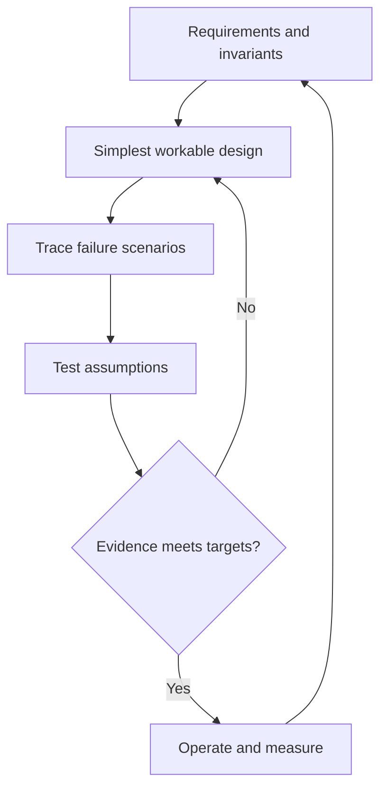

# 100 · Architecture Capstone and Design Defense

[Curriculum index](../../README.md) · [Track index](README.md)

## The problem

Design an appointment platform, then defend how it behaves under growth, outages, and conflicting bookings.

## Prerequisites

Before this session, review: [021](../../designs/03-architecture-and-capacity/021-requirements-and-quality-attributes.md)–[080](../../designs/08-security-and-multi-tenancy/080-threat-modeling-and-security-design-review.md); choose relevant [081](../../designs/09-product-designs/081-url-shortener.md)–[099](../../designs/10-advanced-case-studies/099-large-scale-data-migration-and-cutover.md) cases, explain trade-offs.

If an item is unfamiliar, use the [starter glossary](../../START-HERE.md#starter-glossary) and linked earlier notes. You should be able to explain those items in your own words before moving to the worked approach.

## Predict first

Which requirement determines the strongest consistency boundary?

Write your answer and sketch the relevant state or request sequence before opening the solution.

Hint

Start with one normal operation, then pause it just before and just after its durable change. Identify who owns the truth and what another caller can observe. Use the question above to decide which assumption needs testing.

Worked approach — open after your attempt

## One workable approach

Begin with actors, scope, invariants, measurable targets, and explicit assumptions. Estimate workload, propose the simplest architecture that meets it, then trace booking, cancellation, and notification flows. Define schemas, contracts, transaction boundaries, idempotency, overload behavior, telemetry, and recovery. Add components only when a stated requirement or measured bottleneck demands them. Record alternatives and revisit conditions.

## Flow or state sketch

Boxes represent responsibilities; they do not necessarily require separate deployable services. The text defines the guarantees and limitations.

## Trade-offs and limits

An impressive component list is not evidence of a correct design. A smaller system with explicit ownership, failure behavior, and tested assumptions is easier to defend and operate.

## Failure exercise

Double load, lose a dependency, replay a booking request, and race two users for one slot.

Record the initial state, action sequence, expected durable state, and observed result. Explain the root cause of any mismatch before changing the design.

## 40-minute practice

| Time | Activity |
| --- | --- |
| 5 min | Recall the prerequisites without looking at the notes. |
| 10 min | Read the problem, predict the outcome, and sketch your approach. |
| 15 min | Deliver a one-page design, one sequence diagram, a capacity worksheet, five failure tests, and a three-minute spoken defense. |
| 5 min | Run or trace the failure exercise and improve the design. |
| 5 min | Explain your decision, one alternative, and one limitation aloud. |

This is a design session. A production implementation and its operational validation require additional sessions.

## Explain and revisit

- What invariant or user promise are you protecting?
- Why does your chosen approach fit this problem?
- What evidence would make you change the design?

Record your attempt in the [practice log](../../PRACTICE-LOG.md). Revisit after 2–3 days and again after a week: redraw the flow and explain the failure without rereading first.

---

[Previous: 099](../../designs/10-advanced-case-studies/099-large-scale-data-migration-and-cutover.md) · [Return to index](../../README.md)
